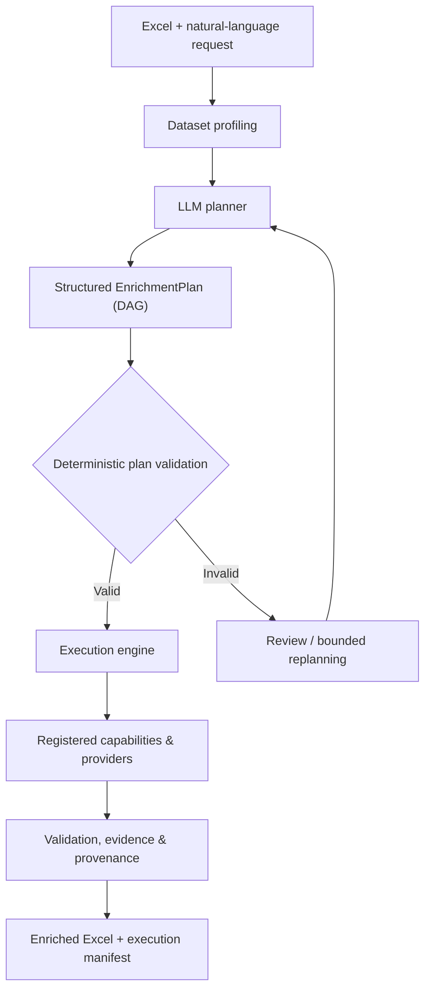

# AI Data Enrichment Studio

**Evidence-driven, agentic enrichment for structured datasets.**

[](https://github.com/ayri77/ai-data-enrichment-studio/actions/workflows/ci.yml)


> **Status: active development — M2 Execution Engine.**
> M1 Planner & Validator is complete. M2 includes an in-memory DAG
> executor, approved provider registry, Open-Meteo geocoding,
> Wikidata mountain resolution/elevation lookup, and deterministic geodesic distance calculation.
> CLI-driven execution and enriched Excel output are not yet available.


## Why this project?

Enriching a spreadsheet often means identifying entities, querying external sources, resolving ambiguous matches, calculating derived values, and checking whether the results are trustworthy. Manual workflows are repetitive, while asking an LLM to fill every cell can be costly, inconsistent, and difficult to audit.

**AI Data Enrichment Studio** aims to make this process **explainable, verifiable, and cost-conscious**. A language model interprets the user's request and builds a structured plan; conventional Python code performs the work where possible. Each result should be traceable to its source or calculation, and unresolved values should be reported rather than invented.

The first input/output adapter targets Excel (`.xlsx`). The longer-term goal is an extensible enrichment engine that is not tied to any particular spreadsheet or domain.

## Example tasks

| Input | User request | Intended operation |
| --- | --- | --- |
| `mountains.xlsx` — mountain names and countries | “Find the elevation of each mountain in meters.” | Resolve entities and retrieve an elevation property |
| `capitals.xlsx` — pairs of capitals and countries | “Calculate straight-line distances in kilometers.” | Resolve coordinates and calculate geodesic distances |
| List of research organizations *(planned)* | “Find official websites, locations, and organization identifiers.” | Resolve identities and retrieve verified attributes |

The first two tasks are the **mandatory acceptance scenarios** for the initial academic MVP. They are **not yet executable end-to-end**.

## Design approach

The proposed architecture combines **agentic planning** with a **deterministic execution engine**.



**Architectural principles**

- **Plan, then execute:** the LLM composes registered capabilities into a declarative operation graph rather than generating arbitrary executable code.
- **Deterministic first:** calculations, type checks, caching, batching, and workbook writes belong to Python components.
- **Controlled tools:** every operation has a defined input/output contract and passes validation before execution.
- **Evidence and uncertainty:** outputs include provenance and explicit unresolved/error statuses; an LLM-generated confidence score is not proof of correctness.
- **Efficiency:** deduplicate repeated lookups, reuse suitable cached results, and respect provider limits.
- **Independent evaluation:** measure correctness, coverage, workbook preservation, latency, and costs against separate reference data.

These are **design goals**, not claims about the capabilities of the current bootstrap implementation.

## Current functionality

Implemented:

- Installable Python 3.12+ package managed with uv.
- Read-only Excel workbook inspection and bounded worksheet profiling.
- Typed capability registry with four built-in semantic capabilities.
- Structured EnrichmentPlan models with DAG dependencies.
- Deterministic plan validation with structured diagnostics.
- LLM-based plan generation using the OpenAI Responses API.
- CLI commands for plan generation, export, revalidation, and evaluation.
- Independent scenario-level planning evaluation for Mountains and Capitals.
- Bounded in-memory multi-row execution and job-scoped deduplication of approved successful operations.
- Automated tests, Ruff, Pyright, and GitHub Actions CI.

Not implemented yet:

- CLI-driven execution of generated enrichment plans.
- Persistent cross-job SQLite caching, retry/rate policies, and execution recovery.
- Enriched Excel workbook generation and result provenance.
- Independent evaluation of enriched numeric values.
- LangGraph orchestration and web application.

### In-memory execution (M2)

The project includes a typed, in-memory DAG execution engine
with explicit provider registration and dependency handling.

Implemented providers:
- Open-Meteo geocoding: city and country resolution to GeoPoint.
- Local geodesic distance: Haversine calculation in kilometers.
- Wikidata mountain resolution: name/country validation, bounded P31/P279 hierarchy checking, and P2044 elevation in meters with source Evidence.

Open-Meteo integration:
- Endpoint: https://geocoding-api.open-meteo.com/v1/search
- Country filtering: ISO 3166-1 alpha-2
- Request timeout: 10 seconds
- Maximum search results: 10
- No API key required
- Explicit error outcomes and source evidence

HTTP-based providers share a JSON transport protocol and typed transport
failures for timeout, network, HTTP status and malformed JSON. HTTP status
and Retry-After metadata are retained at the transport boundary for later
retry policies; no retry logic is enabled yet. Individual providers remain
responsible for validating source-specific response data.

All automated provider tests use offline fixtures or mocked HTTP
responses. Live provider checks are not required by CI.

Single-row Wikidata and Open-Meteo DAG integration tests pass offline.
Multi-row processing and cross-row reuse are implemented in `JobExecutor`
using source-independent `InputRecord` inputs and bounded batches. The job-level
cache is ephemeral and success-only; SQLite persistence and retry/rate policies
remain separate M2 tasks (#35 and #36).

Execution through the CLI and Excel output are not yet implemented.

## Quick start

**Requirements:** Python 3.12+ and [uv](https://docs.astral.sh/uv/).

Clone and install development dependencies:

```bash
git clone https://github.com/ayri77/ai-data-enrichment-studio.git
cd ai-data-enrichment-studio
uv python install 3.12
uv sync --locked --group dev
```

Inspect the included example workbooks without modifying them:

```bash
uv run enrichment version
uv run enrichment inspect samples/capitals.xlsx
uv run enrichment inspect samples/mountains.xlsx
```

The `inspect` command currently returns JSON with worksheet names, column headers, and row counts. It does **not** enrich or save a workbook.

Run quality checks:

```bash
uv run ruff check .
uv run ruff format --check .
uv run pyright
uv run pytest --cov=ai_data_enrichment --cov-report=term-missing
```


### Plan generation and evaluation

Inspect the workbook to identify the correct worksheet name:

```bash
uv run enrichment inspect samples/mountains.xlsx
```

Configure `OPENAI_API_KEY` and optionally `OPENAI_MODEL` in your
environment. When using a local `.env` file, pass `--env-file .env`
to `uv run`.

Generate a plan and export its dataset profile:

```bash
uv run --env-file .env enrichment plan generate samples/mountains.xlsx \
  --sheet Mountains \
  --instruction "Find the elevation of each mountain." \
  --output plan.json \
  --profile-output profile.json
```

Replace `Mountains` with the actual worksheet name if different.

Validate a saved or manually edited plan without calling an LLM:

```bash
uv run enrichment plan validate plan.json --profile profile.json
```

Evaluate structural validity and scenario correctness independently:

```bash
uv run enrichment plan evaluate plan.json \
  --profile profile.json \
  --scenario mountains
```

The evaluation CLI supports `mountains` and `capitals` as benchmark
scenarios. These evaluations assess planning correctness, not the
accuracy of enriched data values.

CLI exit codes:

- `0`: successful validation or evaluation.
- `1`: invalid plan or failed scenario evaluation.
- `2`: invalid input or technical failure.

Plans are generated and validated only. Execution and workbook
enrichment will be introduced in subsequent milestones.


## Roadmap

| Milestone | Scope | Status |
| --- | --- | --- |
| Bootstrap | Package, Excel inspection, tests, CI | **Complete** |
| **M1 — Planner & Validator** | Capability contracts, typed plans, deterministic plan validation, LLM planner | Complete |
| **M2 — Execution Engine** | Providers, operation dependencies, caching, error handling | In progress |
| **M3 — Excel & Evaluation** | Workbook-preserving output, independent benchmarks, mandatory MVP scenarios | Planned |
| **M4 — Agentic Orchestration** | LangGraph, conditional recovery, bounded replanning | Planned |
| **M5 — Portfolio Application** | Organization enrichment, web UI, background jobs, deployment | Future |

The CLI currently supports planning and validation.
An in-memory execution engine is available in Python,
but CLI-driven execution and workbook enrichment
will be introduced in subsequent milestones.

## Technical documentation

The repository follows a **design-for-extension, implement-for-current-needs** approach:

| Document | Contents |
| --- | --- |
| [01 — Product Requirements](docs/01-requirements.md) | Scope, functional and non-functional requirements, acceptance criteria |
| [02 — Conceptual Architecture](docs/02-architecture.md) | Components, responsibilities, execution flow |
| [03 — Domain Model](docs/03-domain-model.md) | Entities, relationships, conceptual contracts |
| [04 — Planning & Capabilities](docs/04-planning-and-capabilities.md) | Initial capabilities, plan schema, validation rules |
| [05 — M2 Job Execution](docs/05-m2-job-execution.md) | Implemented bounded multi-row contract, job-scoped deduplication and metrics (#34) |
| [06 — M2 SQLite Cache](docs/06-m2-persistent-cache.md) | Proposed cross-job cache keys, TTL, typed results and hit/miss metrics (#35) |

Technical documentation and code are in **English**. Academic submission materials for Neoversity will be prepared in **Ukrainian**.

## Development workflow

Development is organized around small, testable changes: **GitHub Issue → feature branch → Pull Request → CI → merge**. Bugs, enhancements, and new capabilities should be tracked in [GitHub Issues](https://github.com/ayri77/ai-data-enrichment-studio/issues).

The project originated as a final assignment for the **Agentic AI** discipline in the Neoversity MSc Artificial Intelligence and Machine Learning program, and is being developed as a longer-term engineering portfolio project.

**License:** No open-source license has been selected yet.
