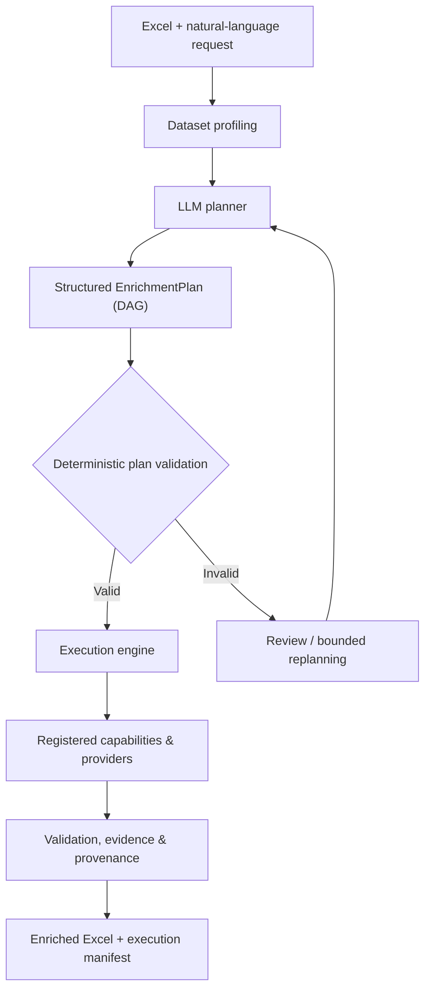

# AI Data Enrichment Studio

**Evidence-driven, agentic enrichment for structured datasets.**

[](https://github.com/ayri77/ai-data-enrichment-studio/actions/workflows/ci.yml)


> **Status: active development — M1, M2, and the bounded M3 Core MVP complete.**
>
> M3 delivers validated Excel I/O, CLI execution, audited entity resolution,
> a mountain Review → Approve → Resume example, Capitals E2E, independent
> **smoke-level** references for both academic scenarios, and the offline
> 1,000-row Excel benchmark.
>
> **Limits:** unit checks are enforced when `OutputMapping.expected_unit`
> is declared; occupied cells are never overwritten. Large-sample factual
> accuracy evaluation, generic grouped review/export, strict unit-declaration
> mode, and automatic unit conversion remain tracked enhancements.
>
> See [M3 Core Acceptance](docs/15-m3-core-acceptance.md),
> [M3 Epic #4](https://github.com/ayri77/ai-data-enrichment-studio/issues/4),
> and [Mountain Resume demo](demo/README.md).

## Why this project?

Enriching a spreadsheet often means identifying entities, querying external sources, resolving ambiguous matches, calculating derived values, and checking whether the results are trustworthy. Manual workflows are repetitive, while asking an LLM to fill every cell can be costly, inconsistent, and difficult to audit.

**AI Data Enrichment Studio** aims to make this process **explainable, verifiable, and cost-conscious**. A language model interprets the user's request and builds a structured plan; conventional Python code performs the work where possible. Each result should be traceable to its source or calculation, and unresolved values should be reported rather than invented.

The first input/output adapter targets Excel (`.xlsx`). The longer-term goal is an extensible enrichment engine that is not tied to any particular spreadsheet or domain.

## Example tasks

| Input | User request | Intended operation |
| --- | --- | --- |
| `mountains.xlsx` — mountain names and countries | “Find the elevation of each mountain in meters.” | Resolve entities and retrieve an elevation property |
| `capitals.xlsx` — pairs of capitals and countries | “Calculate straight-line distances in kilometers.” | Resolve coordinates and calculate geodesic distances |
| List of research organizations *(planned)* | “Find official websites, locations, and organization identifiers.” | Resolve identities and retrieve verified attributes |

The first two tasks are the **mandatory acceptance scenarios** for the
initial academic MVP.

The Mountain Elevation workflow has been demonstrated end-to-end with a
one-row live Wikidata example, including user approval and audited resume.
The Capitals workflow now has controlled offline Excel end-to-end
coverage, including a 1,000-row benchmark. Independent ground-truth
evaluation and the remaining M3 acceptance criteria are still open.

## Design approach

The proposed architecture combines **agentic planning** with a **deterministic execution engine**.



**Architectural principles**

- **Plan, then execute:** the LLM composes registered capabilities into a declarative operation graph rather than generating arbitrary executable code.
- **Deterministic first:** calculations, type checks, caching, batching, and workbook writes belong to Python components.
- **Controlled tools:** every operation has a defined input/output contract and passes validation before execution.
- **Evidence and uncertainty:** outputs include provenance and explicit unresolved/error statuses; an LLM-generated confidence score is not proof of correctness.
- **Efficiency:** deduplicate repeated lookups, reuse suitable cached results, and respect provider limits.
- **Independent evaluation:** measure correctness, coverage, workbook preservation, latency, and costs against separate reference data.

These principles guide the implemented architecture. Some capabilities,
including independent output evaluation, agentic recovery, and the web
application, remain under development.

## Current functionality

Implemented:

- Installable Python 3.12+ package managed with uv.
- Read-only Excel workbook inspection and bounded dataset profiling.
- Explicit worksheet range selection with shared profiling and record-reading
  boundaries, including tables that do not start at A1.
- Typed capability registry with four built-in semantic capabilities.
- Structured EnrichmentPlan models with DAG dependencies.
- Deterministic plan validation with structured diagnostics.
- LLM-based plan generation using the OpenAI Responses API.
- CLI commands for plan generation, export, revalidation, and evaluation.
- Independent scenario-level planning evaluation for Mountains and Capitals.
- Bounded in-memory multi-row execution and job-scoped deduplication of approved successful operations.
- Optional versioned SQLite reuse of verified successful operations across independent jobs, with TTL and source Evidence.
- Opt-in shared Resolution Engine with deterministic geographic ranking, bounded Wikidata candidate verification, and typed `ResolutionReport` (strict/abstaining by default).
- Opt-in JobExecutor audit: per-record/step links, safe in-job reuse, separate policy-aware SQLite storage of paired results and decision reports.
- Bounded LangGraph orchestration with optional LLM plan repair, explicit execution outcome classification, and an opt-in SQLite whole-job execution journal (see [M4-3 recovery scope](docs/16-m4-controlled-recovery.md)).
- Automated tests, Ruff, Pyright, and GitHub Actions CI.
- Excel input adapter with typed records and original worksheet row mapping.
- Safe Excel output adapter that creates a separate workbook, rejects occupied
  target cells, and preserves supported source content and formatting.
- End-to-end CLI execution of saved enrichment plans through the validated
  DAG and registered providers, with explicit network opt-in.
- Audited resolution reports containing candidates, decisions, Evidence,
  and per-record operation references.
- Human-in-the-loop Review → Approve → Resume for audited Wikidata mountain
  resolution, including workbook-bound approvals, fresh verification,
  and previous-job provenance.
- Reproducible Mountain Elevation demo with live Wikidata results.

Not implemented yet:

- Automatic discovery and selection of arbitrary Excel tables, including
  selection by structured Excel Table name.
- Final M3 acceptance sign-off for both mandatory workbooks, including
  independently validated reference values.
- Independent ground-truth evaluation of enriched numeric values.
- Explicit destination-unit compatibility validation and conversion.
- General-purpose approval and resume workflows for other entity types,
  grouped review questions, and selective dependent-step replay.
- Durable LangGraph node checkpointing and automatic mid-DAG resume (deferred; see [M4-3 recovery scope](docs/16-m4-controlled-recovery.md)).
- Web application, interactive Review Workspace, and deployment.

### In-memory execution (M2)

The project includes a typed, in-memory DAG execution engine
with explicit provider registration and dependency handling.

Implemented providers:
- Open-Meteo geocoding: city and country resolution to GeoPoint.
- Local geodesic distance: Haversine calculation in kilometers.
- Wikidata mountain resolution: name/country validation, bounded P31/P279 hierarchy checking, and P2044 elevation in meters with source Evidence.

Open-Meteo integration:
- Endpoint: https://geocoding-api.open-meteo.com/v1/search
- Country filtering: ISO 3166-1 alpha-2
- Request timeout: 10 seconds
- Maximum search results: 10
- No API key required
- Explicit error outcomes and source evidence

HTTP-based providers share a JSON transport protocol and typed transport
failures for timeout, network, HTTP status and malformed JSON. The opt-in
`RetryingJsonTransport` implements bounded transient retries and Retry-After
handling. An optional `ProviderRequestSession` now enforces per-job,
provider-specific physical HTTP attempt budgets, rate pacing and optional
uncached operation caps across different handlers. Neither is installed
automatically; the application must inject the policy-wrapped transports.
Individual providers still validate source-specific response data. An optional
registry-approved fallback coordinator requires an explicit application-owned
semantic contract, expected result type/unit and source Evidence; it is off by
default. There is no configured interchangeable fallback for current
Wikidata/Open-Meteo provider adapters.

All automated provider tests use offline fixtures or mocked HTTP
responses. Live provider checks are not required by CI.

Single-row Wikidata and Open-Meteo DAG integration tests pass offline.
Multi-row processing and cross-row reuse are implemented in `JobExecutor`
using source-independent `InputRecord` inputs and bounded batches. The job-level
cache is ephemeral and success-only. An explicitly configured local SQLite cache
adds cross-job reuse of successful results with provider-specific TTL, semantic
versions and original Evidence. Cache hits and handler-boundary invocations
have separate metrics; provider request counters distinguish actual HTTP attempts
and operations blocked by policy. Optional provider request policies expose physical HTTP
attempts, rate waits and blocked requests. Typed transient retry exhaustion
and opt-in fallback attempts/successes are separately observable (#36).

### M2 measured offline acceptance benchmark (developer tool)

The [M2 acceptance report](docs/12-m2-acceptance.md) documents two
**1000-row, real-DAG / mocked-provider** workloads and adversarial abstention
fixtures. This is a reproducible fixture benchmark, not production external
API latency or independent factual-accuracy validation:

```bash
uv run --locked python scripts/benchmark_m2.py --rows 1000
```

The CI workflow runs this after lint, type checks and pytest. It reports
logical DAG operations, executed handlers, memo reuse, synthetic transport
attempts, per-record resolution links, Evidence counts, and measured
`JobExecutor.execute` time. It does not open network connections, read
production data, or modify workbooks. The benchmark currently measures a
*small number of repeated distinct queries*, not 1000 unique entities.

### M3 offline Excel end-to-end benchmark (developer tool)

The benchmark creates a temporary Excel workbook, executes the real
`ExcelEnrichmentRunner` and audited resolution pipeline against validated,
network-free Open-Meteo fixtures, and checks the output workbook, source
immutability, execution metrics and audit row links. This measures a
**controlled pipeline workload**, not real provider latency or independent
ground-truth correctness.

```powershell
uv run python -m scripts.benchmark_m3_excel --scenario benchmarks/scenarios/capitals_repeated.json
uv run python -m scripts.benchmark_m3_excel --scenario benchmarks/scenarios/unique_cities.json
uv run python -m scripts.benchmark_m3_excel --rows 1000 --profile-memory
```

The first scenario uses repeated Berlin/Kyiv capitals; the second cycles
through four city/country pairs. The third command uses the default capitals
fixture and profiles peak Python allocations with `tracemalloc`.
`logical_operations` counts per-row DAG operations;
`executed_handler_calls` counts uncached handler invocations;
`reused_operations` counts memo hits; `transport_calls` counts fixture
requests (not HTTP traffic); `audit_operations` counts *deduplicated*
resolution reports; `audit_record_step_links` counts the row/step audit
references. A zero memo capacity disables operation-result reuse without
removing audit links. The current benchmark validates only disabled or
sufficiently provisioned memo capacities; intermediate capacities are not
a supported acceptance mode.

### Reproducible M2 smoke scenarios (developer tool)

These checks use the real `PlanValidator`, `JobExecutor`, provider adapters,
request policy and typed `Evidence`, without editing input workbooks.
They do **not** perform full Excel enrichment.

Run from the repository root after `uv sync --locked --group dev`:

```powershell
# Offline by default; deterministic fixture data, no API keys or network
uv run python scripts/smoke_live_providers.py --scenario capitals
uv run python scripts/smoke_live_providers.py --scenario mountains

# SQLite reuse across two independent jobs, using a disposable temporary DB
uv run python scripts/smoke_live_providers.py --scenario capitals --mode cache
uv run python scripts/smoke_live_providers.py --scenario mountains --mode cache

# Explicit, bounded external API traffic. Do not run these in CI.
uv run python scripts/smoke_live_providers.py --scenario capitals --mode live --allow-network
uv run python scripts/smoke_live_providers.py --scenario mountains --mode live --allow-network
```

For debugging live-source mismatches, enable a sanitized, bounded
provider response trace (public location/country/QID/class metadata only).
This does **not** increase HTTP request limits or loosen validation:

```powershell
uv run python scripts/smoke_live_providers.py --scenario capitals --mode live --allow-network --diagnose
uv run python scripts/smoke_live_providers.py --scenario mountains --mode live --allow-network --diagnose
```

The `source_trace` field shows Open-Meteo candidate names/feature codes and
Wikidata search candidates plus P31/P279 class references for requested
entities. It does not print HTTP headers, raw JSON payloads or API credentials.
Use this only for developer diagnosis; it is not a substitute for a domain
ambiguity policy and does not run in CI.

The live runs process **one** input record. Open-Meteo has a hard job budget
of 4 HTTP attempts; Wikidata has 16. Both are paced at 0.75 seconds between
requests and use **no automatic retries**. Live mode cannot start without
`--allow-network`. No OpenAI call is made. The JSON report includes per-step
typed outcomes, `Evidence`, provider request counters, job metrics and elapsed
time. A failed or partial record returns process exit code 1.

**Important:** The offline fixture provides a known demonstration value for
Mount Everest; the live Wikidata result can differ or fail because of current
source data, ambiguity or provider rate limits. Do not treat smoke fixtures as
independent ground-truth accuracy evaluation.

### Audited Resolution Foundation (M2)

**Implemented, opt-in (PRs #69–#74):** provider adapters retrieve and verify
normalized candidates, while the shared `ResolutionEngine` applies source-independent
decision semantics with provider-specific ranking strategies. `JobExecutor` can
connect `OpenMeteoResolutionService` and `WikidataMountainResolutionService`
through explicitly selected `resolution_services` and `resolution_policies`,
returning a typed `ResolutionJobReport` with each operation's alternatives,
reason codes, completeness and per-row links.

Uncertain or incomplete candidates never become a successful downstream result.
Prominence-based auto-selection is explicitly enabled, not inferred from the
LLM or search position. The same candidate decision plus its evidence is cached
as a pair with the corresponding successful result, under policy/version/context-
specific keys. Strict legacy handlers still run when opt-in is absent.
See [Resolution Report Contract](docs/10-resolution-report-contract.md).

**M3 update (PR #79):** Excel execution, workbook output, and validated
user-approved resume are implemented for audited Wikidata mountain
resolution. The resume workflow includes fresh source verification
and links to the original job.

General-purpose review workflows, grouped clarification questions,
selective dependent-step replay, and the web Review Workspace remain
future work. Live provider access requires explicit opt-in.

## Quick start

**Requirements:** Python 3.12+ and [uv](https://docs.astral.sh/uv/).

Clone and install development dependencies:

```bash
git clone https://github.com/ayri77/ai-data-enrichment-studio.git
cd ai-data-enrichment-studio
uv python install 3.12
uv sync --locked --group dev
```

Inspect the included example workbooks without modifying them:

```bash
uv run enrichment version
uv run enrichment inspect samples/capitals.xlsx
uv run enrichment inspect samples/mountains.xlsx
```

The `inspect` command currently returns JSON with worksheet names, column headers, and row counts. It does **not** enrich or save a workbook.

Run quality checks:

```bash
uv run ruff check .
uv run ruff format --check .
uv run pyright
uv run pytest --cov=ai_data_enrichment --cov-report=term-missing
```


### Plan generation and evaluation

Inspect the workbook to identify the correct worksheet name:

```bash
uv run enrichment inspect samples/mountains.xlsx
```

Configure `OPENAI_API_KEY` and optionally `OPENAI_MODEL` in your
environment. When using a local `.env` file, pass `--env-file .env`
to `uv run`.

Generate a plan and export its dataset profile:

```bash
uv run --env-file .env enrichment plan generate samples/mountains.xlsx \
  --sheet Mountains \
  --instruction "Find the elevation of each mountain." \
  --output plan.json \
  --profile-output profile.json
```

Replace `Mountains` with the actual worksheet name if different.

Validate a saved or manually edited plan without calling an LLM:

```bash
uv run enrichment plan validate plan.json --profile profile.json
```

Evaluate structural validity and scenario correctness independently:

```bash
uv run enrichment plan evaluate plan.json \
  --profile profile.json \
  --scenario mountains
```

The evaluation CLI supports `mountains` and `capitals` as benchmark
scenarios. These evaluations assess planning correctness, not the
accuracy of enriched data values.

CLI exit codes:

- `0`: successful validation or evaluation.
- `1`: invalid plan or failed scenario evaluation.
- `2`: invalid input or technical failure.

### Execute an Excel enrichment job (M3)

The `enrichment run` command executes a saved, validated plan
against an explicitly selected Excel table and writes the results
to a new workbook.

A reproducible Mountain Elevation example is available in
[demo/README.md](demo/README.md).

The example demonstrates the Review → Approve → Resume workflow
using a previously reviewed Wikidata candidate.

Run from the repository root in PowerShell:

```powershell
New-Item -ItemType Directory -Path temp -Force | Out-Null

uv run --locked enrichment run demo/mountains_smoke.xlsx `
    --plan demo/mountains_plan.json `
    --sheet Mountains `
    --range A1:B2 `
    --columns-file demo/columns.json `
    --output temp/mountains_reproduced.xlsx `
    --allow-network `
    --max-rows 1 `
    --approvals-file demo/mountains_approvals.json `
    --source-report demo/mountains_enriched_audited.resolution.json
```

The command produces an enriched XLSX file and a corresponding
resolution audit report.

**Important limitations:**

- External API access requires explicit `--allow-network`.
- The command processes up to 1,000 rows per job.
- Approval-based resume currently supports audited Wikidata
  mountain resolution.
- Approval manifests are bound to the original workbook and job.
- Output files must not already exist.
- Live provider responses may change or fail.
- This example demonstrates functionality, not independently
  measured factual accuracy.

The `temp/` directory is excluded from Git. Published demonstration
artifacts remain in `demo/`.

## Roadmap

| Milestone | Scope | Status |
| --- | --- | --- |
| Bootstrap | Package, Excel inspection, tests, CI | **Complete** |
| **M1 — Planner & Validator** | Capability contracts, typed plans, deterministic validation, LLM planner | **Complete** |
| **M2 — Execution Engine** | DAG execution, providers, caching, reliability, audited entity resolution | **Complete** |
| **M3 — Excel & Evaluation** | Safe Excel I/O, audited resume, Capitals E2E, curated external reference checks, offline 1,000-row benchmark | **Core complete; extensions tracked** |
| **M4 — Agentic Orchestration** | LangGraph, conditional recovery, bounded replanning, optional LLM clarification | Planned |
| **M5 — Portfolio Application** | Organization enrichment, web UI, Review Workspace, background jobs, deployment | Future |

The CLI supports workbook inspection, plan generation, validation,
planning evaluation, and execution of saved plans with Excel output.

The M3 **Core MVP** was accepted after PR #89 and CI. The external
reference checks are two representative examples, **not** population
accuracy estimates. Advanced review and evaluation extensions remain
tracked under #20, #21, #22 and #66; they do not block M4.

See the [M3 acceptance report](docs/15-m3-core-acceptance.md) and
[M3 Epic #4](https://github.com/ayri77/ai-data-enrichment-studio/issues/4).

## Technical documentation

The repository follows a **design-for-extension, implement-for-current-needs** approach:

| Document | Contents |
| --- | --- |
| [01 — Product Requirements](docs/01-requirements.md) | Scope, functional and non-functional requirements, acceptance criteria |
| [02 — Conceptual Architecture](docs/02-architecture.md) | Components, responsibilities, execution flow |
| [03 — Domain Model](docs/03-domain-model.md) | Entities, relationships, conceptual contracts |
| [04 — Planning & Capabilities](docs/04-planning-and-capabilities.md) | Initial capabilities, plan schema, validation rules |
| [05 — M2 Job Execution](docs/05-m2-job-execution.md) | Implemented bounded multi-row contract, job-scoped deduplication and metrics (#34) |
| [06 — M2 SQLite Cache](docs/06-m2-persistent-cache.md) | Versioned cross-job cache keys, TTL, typed results and hit/miss metrics (#35) |
| [07 — M2 Provider Reliability](docs/07-m2-provider-reliability.md) | Implemented opt-in HTTP retries, per-provider request budgets and registered fallback contracts (#36) |
| [08 — Resolution Foundation](docs/08-resolution-foundation.md) | Proposed hybrid architecture: source-specific candidate verification, shared policies, audit and review semantics (#61) |
| [09 — Resolution Rollout](docs/09-resolution-rollout.md) | Work plan, issue sequence, milestone boundaries and acceptance gates (#61–#68) |
| [10 — Resolution Report Contract](docs/10-resolution-report-contract.md) | Implemented Resolution Report v1, audited JobExecutor integration, and M3 approval-based resume |
| [14 — Implementation Reading Guide](docs/14-implementation-reading-guide.md) | Suggested module reading order, end-to-end pipeline, and key safety/audit invariants |
| [15 — M3 Core Acceptance](docs/15-m3-core-acceptance.md) | Core acceptance evidence, independent reference checks, limitations and explicit deferrals |

Technical documentation and code are in **English**. Academic submission materials for Neoversity will be prepared in **Ukrainian**.

## Development workflow

Development is organized around small, testable changes: **GitHub Issue → feature branch → Pull Request → CI → merge**. Bugs, enhancements, and new capabilities should be tracked in [GitHub Issues](https://github.com/ayri77/ai-data-enrichment-studio/issues).

The project originated as a final assignment for the **Agentic AI** discipline in the Neoversity MSc Artificial Intelligence and Machine Learning program, and is being developed as a longer-term engineering portfolio project.

**License:** No open-source license has been selected yet.
