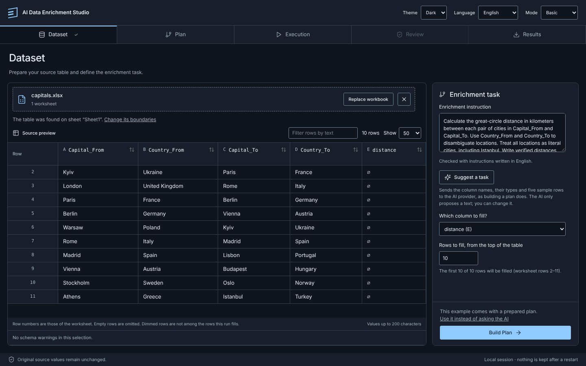
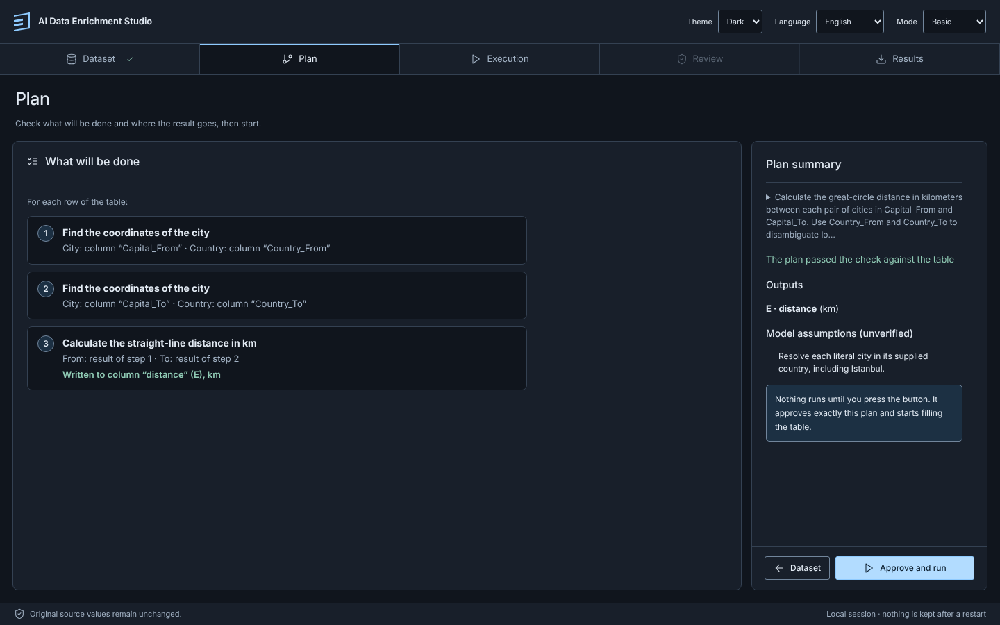
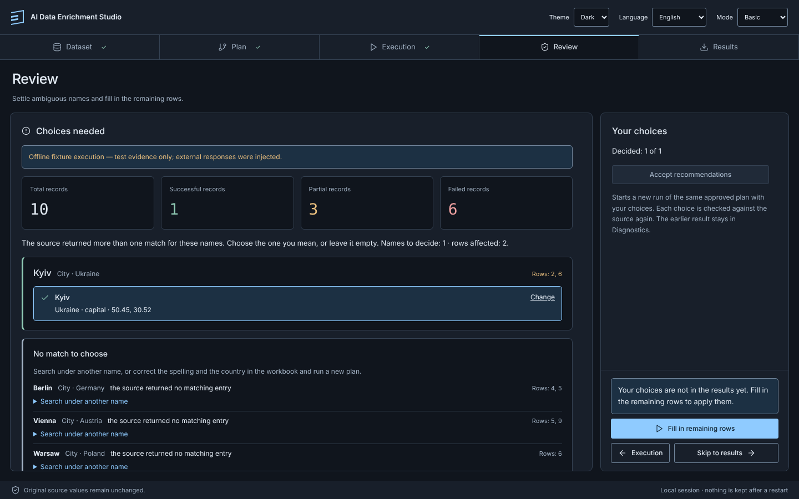
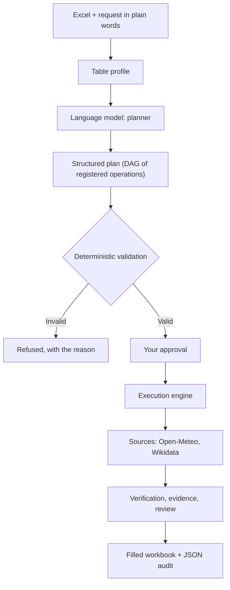

# AI Data Enrichment Studio

**Fill a spreadsheet column from external sources, with a plan you approve and an audit of every value.**

[](https://github.com/ayri77/ai-data-enrichment-studio/actions/workflows/ci.yml)


You upload an Excel workbook and say in plain words what to fill in. A language
model turns the request into a structured plan; the plan is checked against the
table; after you approve it, ordinary Python code looks the values up in open
sources and writes them into a copy of your file. A value the sources cannot
confirm is left empty and explained, not invented.

> **Status: MVP.** Both sample tasks run end to end in the browser. The scope is
> deliberately small — see [What it can do](#what-it-can-do) and
> [Limits](#limits).



## Why

Enriching a spreadsheet means identifying entities, querying sources, resolving
ambiguous matches, calculating derived values and checking the result. Doing it
by hand is repetitive. Asking a language model to fill every cell is costly,
inconsistent and hard to audit.

Here the model only plans. It composes registered operations into a plan and
never writes a cell itself. Lookups, calculations, type checks and workbook
writes are deterministic code, and every value carries the source record it
came from.

## What it can do

| Task | What happens |
| --- | --- |
| Coordinates of a city | The city is looked up in Open-Meteo's geocoding service, within the country given in the row |
| Distance between two cities | Both cities are found, then the straight-line distance is calculated |
| Elevation of a mountain | The mountain is found in Wikidata and its elevation is read from the record |

The table needs the names and their countries. A country may be written in any
language or as a two-letter code.

## How a run goes

The interface has five workspaces, passed in order.

1. **Dataset.** Upload an `.xlsx` workbook or pick an example. The table is found
   on the sheet and shown whole, with a text filter and sorting. Describe the
   task — or let the AI propose one — and choose the column to fill and how many
   rows to take.
2. **Plan.** The plan is shown as numbered steps in plain words. Nothing runs
   until you approve it; approval applies to exactly this plan and this table.

   
3. **Execution.** The run reports its progress in rows and ends with a one-line
   summary.
4. **Review.** Where a name has several matches, you choose one; candidates come
   with country, coordinates, population or elevation and a map. A name the
   source does not know can be searched under another name, typed by you or
   proposed by the AI. Each choice is verified against the source again.

   
5. **Results.** Every row says whether it was filled and why not. Download the
   filled workbook — a separate copy; your file is never changed — and a JSON
   audit that records how each value was obtained, including your choices.

The screenshots come from the offline test setup, whose injected source answers
know only a few cities.

**Basic** mode shows only what is needed to get a result. **Advanced** adds the
plan graph, a column inspector, run metrics, policies and diagnostics. The
interface is available in English, Ukrainian and German, light and dark.

## Run it locally

**Requirements:** Python 3.12+, [uv](https://docs.astral.sh/uv/) and Node.js 24.

```bash
git clone https://github.com/ayri77/ai-data-enrichment-studio.git
cd ai-data-enrichment-studio
uv sync --locked --group dev

# Terminal 1: the API, on 127.0.0.1:8010
uv run --locked python -m ai_data_enrichment.local_server --allow-network

# Terminal 2: the interface, on 127.0.0.1:5173
cd frontend
npm ci
npm run dev
```

Open <http://127.0.0.1:5173>.

- **Without a key** you can try both examples: each comes with a prepared plan,
  so no language model is needed. Lookups still go to Open-Meteo and Wikidata.
- **With an OpenAI key** you can describe your own task. Enter the key under
  *Provider / Model settings* (it stays in the memory of the local process), or
  put `OPENAI_API_KEY` and `OPENAI_MODEL` into `.env` (see `.env.example`) and
  add `--env-file .env` after `uv run --locked`.
- **`--allow-network`** lets the server reach the sources and the model. Without
  it nothing leaves your machine and only plan validation works.

Details: [provider settings](docs/25-provider-settings.md).

## Hosted demo

The same application runs as one process behind a shared access code, with the
model key held on the server. See [hosted demo](docs/27-hosted-demo.md) for the
Docker image, the Render blueprint (`render.yaml`) and the limits of a hosted
instance.

## How it is built



- **Plan, then execute.** The model composes registered operations into a
  declarative graph; it does not generate code.
- **Validated before anything runs.** A plan is checked against the table and
  the operation contracts, and against what the instruction asked for.
- **Evidence over confidence.** An entity is accepted only when the source
  confirms it; otherwise the row goes to Review or stays empty. A model's own
  confidence is not evidence.
- **Your file is not touched.** Results go into a copy; cells that already have
  a value are kept unless you ask to replace them, and every replacement is
  listed in the audit.
- **Bounded.** A run has limits on rows, source requests and time.

Backend: Python 3.12, FastAPI, Pydantic, openpyxl. Frontend: React, TypeScript,
Vite. Start reading the code with the
[implementation reading guide](docs/14-implementation-reading-guide.md).

## Limits

- **Three tasks.** Cities and mountains only; adding a source or an operation
  means writing code.
- **One run fills up to 20 rows by default.** `ENRICHMENT_MAX_RUN_ROWS` raises
  this locally, up to 5,000. A run is stopped after 300 seconds. Runs are not
  parallel: 50 mountains took about two minutes in a live measurement.
- **Workbooks:** `.xlsx` up to 10 MiB and 16 worksheets; a table up to 5,000
  rows, 100 columns and 100,000 cells. A run takes rows from the top of the
  table.
- **Nothing is stored.** Workbooks, plans, runs and keys live in the memory of
  one process and are gone after a restart. One run at a time.
- **One model provider** (OpenAI). `gpt-4.1-mini` is the default and the only
  model whose planning was measured: 10 of 10 valid plans on each sample task
  ([live planning reliability](docs/26-live-planning-reliability.md)).
  Instructions were measured in English only.
- **Accuracy is not measured at scale.** The two 10-row samples were run against
  live sources ([record of 2026-11-09](docs/18-academic-live-acceptance.md)).
  That is evidence for those rows, not an estimate of entity-resolution accuracy
  in general.

## Development

```bash
uv run --locked ruff check .
uv run --locked ruff format --check .
uv run --locked pyright
uv run --locked pytest

cd frontend
npm run format:check && npm test && npm run build
npm run test:e2e   # browser scenarios against injected source answers
```

Tests never call a live source or model; live checks are separate scripts that
need an explicit opt-in. Work goes through an issue or a described task, a
branch, a pull request and CI.

## Documentation

| Document | Contents |
| --- | --- |
| [Five-workspace interface](docs/24-five-workspace-ui.md) | What each workspace shows in Basic and Advanced, and how it is tested |
| [Plan/Run API](docs/22-m5-plan-run-api.md) | Routes, bounds, review and resume, the audit report |
| [Provider settings](docs/25-provider-settings.md) | Model and key for a local process |
| [Live planning reliability](docs/26-live-planning-reliability.md) | How planning was measured, the model catalogue, how to repeat the measurement |
| [Hosted demo](docs/27-hosted-demo.md) | Docker image, Render, access code, limits |
| [Command-line and developer tools](docs/28-cli-and-developer-tools.md) | The `enrichment` CLI, benchmarks, experiment scripts, developer demos |
| [Requirements](docs/01-requirements.md) · [Architecture](docs/02-architecture.md) · [Domain model](docs/03-domain-model.md) | The design the project started from |
| [Resolution foundation](docs/08-resolution-foundation.md) · [Resolution report](docs/10-resolution-report-contract.md) | How an entity is found, verified and audited |
| [Implementation reading guide](docs/14-implementation-reading-guide.md) | Reading order for the modules and the invariants they keep |
| [Product roadmap](docs/20-product-roadmap-ui-agent.md) | What is planned after the MVP |

Documentation and code are in English.

## About

The project began as the final assignment for the **Agentic AI** course of the
Neoversity MSc programme in Artificial Intelligence and Machine Learning, and
continues as an engineering portfolio project.

**License:** no open-source license has been selected yet.
