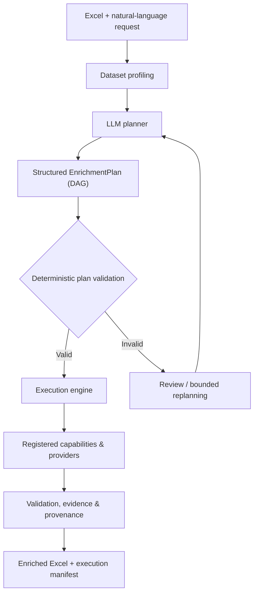

# AI Data Enrichment Studio

**Evidence-driven, agentic enrichment for structured datasets.**

[](https://github.com/ayri77/ai-data-enrichment-studio/actions/workflows/ci.yml)


> **Status: early development.** The Python package, Excel inspection CLI, tests, and CI are implemented. AI planning, enrichment execution, validation, and the web interface are planned but **not yet available**.

## Why this project?

Enriching a spreadsheet often means identifying entities, querying external sources, resolving ambiguous matches, calculating derived values, and checking whether the results are trustworthy. Manual workflows are repetitive, while asking an LLM to fill every cell can be costly, inconsistent, and difficult to audit.

**AI Data Enrichment Studio** aims to make this process **explainable, verifiable, and cost-conscious**. A language model interprets the user's request and builds a structured plan; conventional Python code performs the work where possible. Each result should be traceable to its source or calculation, and unresolved values should be reported rather than invented.

The first input/output adapter targets Excel (`.xlsx`). The longer-term goal is an extensible enrichment engine that is not tied to any particular spreadsheet or domain.

## Example tasks

| Input | User request | Intended operation |
| --- | --- | --- |
| `mountains.xlsx` — mountain names and countries | “Find the elevation of each mountain in meters.” | Resolve entities and retrieve an elevation property |
| `capitals.xlsx` — pairs of capitals and countries | “Calculate straight-line distances in kilometers.” | Resolve coordinates and calculate geodesic distances |
| List of research organizations *(planned)* | “Find official websites, locations, and organization identifiers.” | Resolve identities and retrieve verified attributes |

The first two tasks are the **mandatory acceptance scenarios** for the initial academic MVP. They are **not yet executable end-to-end**.

## Design approach

The proposed architecture combines **agentic planning** with a **deterministic execution engine**.



**Architectural principles**

- **Plan, then execute:** the LLM composes registered capabilities into a declarative operation graph rather than generating arbitrary executable code.
- **Deterministic first:** calculations, type checks, caching, batching, and workbook writes belong to Python components.
- **Controlled tools:** every operation has a defined input/output contract and passes validation before execution.
- **Evidence and uncertainty:** outputs include provenance and explicit unresolved/error statuses; an LLM-generated confidence score is not proof of correctness.
- **Efficiency:** deduplicate repeated lookups, reuse suitable cached results, and respect provider limits.
- **Independent evaluation:** measure correctness, coverage, workbook preservation, latency, and costs against separate reference data.

These are **design goals**, not claims about the capabilities of the current bootstrap implementation.

## Current functionality

Implemented:

- Installable Python 3.12+ package managed with **uv**.
- `enrichment version` and read-only `enrichment inspect` commands.
- Excel workbook inspection: worksheet names, column headers, and data-row counts.
- Unit/integration test skeleton with **pytest**.
- **Ruff**, **Pyright**, and automated **GitHub Actions CI** checks.

Not implemented yet: LLM plan generation, capability execution, external data lookups, enriched Excel export, evaluation metrics, persistent jobs, and UI.

## Quick start

**Requirements:** Python 3.12+ and [uv](https://docs.astral.sh/uv/).

Clone and install development dependencies:

```bash
git clone https://github.com/ayri77/ai-data-enrichment-studio.git
cd ai-data-enrichment-studio
uv python install 3.12
uv sync --locked --group dev
```

Inspect the included example workbooks without modifying them:

```bash
uv run enrichment version
uv run enrichment inspect samples/capitals.xlsx
uv run enrichment inspect samples/mountains.xlsx
```

The `inspect` command currently returns JSON with worksheet names, column headers, and row counts. It does **not** enrich or save a workbook.

Run quality checks:

```bash
uv run ruff check .
uv run ruff format --check .
uv run pyright
uv run pytest --cov=ai_data_enrichment --cov-report=term-missing
```

## Roadmap

| Milestone | Scope | Status |
| --- | --- | --- |
| Bootstrap | Package, Excel inspection, tests, CI | **Complete** |
| **M1 — Planner & Validator** | Capability contracts, typed plans, deterministic plan validation, LLM planner | Planned |
| **M2 — Execution Engine** | Providers, operation dependencies, caching, error handling | Planned |
| **M3 — Excel & Evaluation** | Workbook-preserving output, independent benchmarks, mandatory MVP scenarios | Planned |
| **M4 — Agentic Orchestration** | LangGraph, conditional recovery, bounded replanning | Planned |
| **M5 — Portfolio Application** | Organization enrichment, web UI, background jobs, deployment | Future |

Longer-term possibilities include reusable user-defined scenarios and an **AI Perception Observatory** for studying how organizations and products appear across AI systems. These are not part of the academic MVP.

## Technical documentation

The repository follows a **design-for-extension, implement-for-current-needs** approach:

| Document | Contents |
| --- | --- |
| [01 — Product Requirements](docs/01-requirements.md) | Scope, functional and non-functional requirements, acceptance criteria |
| [02 — Conceptual Architecture](docs/02-architecture.md) | Components, responsibilities, execution flow |
| [03 — Domain Model](docs/03-domain-model.md) | Entities, relationships, conceptual contracts |
| [04 — Planning & Capabilities](docs/04-planning-and-capabilities.md) | Initial capabilities, plan schema, validation rules |

Technical documentation and code are in **English**. Academic submission materials for Neoversity will be prepared in **Ukrainian**.

## Development workflow

Development is organized around small, testable changes: **GitHub Issue → feature branch → Pull Request → CI → merge**. Bugs, enhancements, and new capabilities should be tracked in [GitHub Issues](https://github.com/ayri77/ai-data-enrichment-studio/issues).

The project originated as a final assignment for the **Agentic AI** discipline in the Neoversity MSc Artificial Intelligence and Machine Learning program, and is being developed as a longer-term engineering portfolio project.

**License:** No open-source license has been selected yet.
