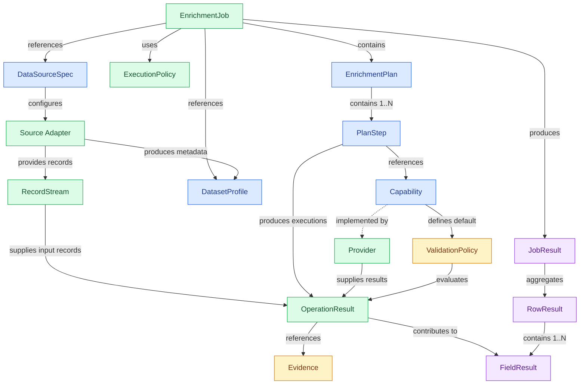

# AI Data Enrichment Studio
## Domain Model and Conceptual Contracts

**Document ID:** DOMAIN-001  
**Version:** 0.1  
**Status:** Proposed  
**Related documents:**
- [Product Requirements](01-requirements.md)
- [Conceptual Architecture](02-architecture.md)

---

## 1. Purpose

This document defines the core domain concepts, responsibilities, relationships, and conceptual data contracts of AI Data Enrichment Studio.

The domain model serves as a common foundation for:

- Agentic planning.
- Deterministic plan execution.
- Capability and provider integration.
- Validation and evidence tracking.
- Result management.
- Workflow orchestration.
- Independent evaluation.

The definitions are technology-independent unless otherwise specified.

Concrete Python interfaces, Pydantic schemas, database models, and LangGraph state definitions will be derived during detailed technical design.

---

## 2. Domain Modeling Principles

### 2.1 Separation of Planning and Execution

The LLM produces a declarative description of the intended operations.

The execution engine interprets and executes the validated plan using registered capabilities.

An EnrichmentPlan must not contain executable Python code, arbitrary network requests, or unregistered tool definitions.

### 2.2 Explicit Data Contracts

Each operation must declare its expected inputs and outputs.

Operation dependencies must be validated before execution.

### 2.3 Format Independence

Domain entities must not depend on Excel-specific implementation objects.

Workbook, worksheet, row, and cell references belong to input/output mapping contracts rather than core enrichment logic.

### 2.4 Evidence and Uncertainty

Retrieved values must retain relevant provenance.

Technical success, factual verification, and source reliability are distinct concepts.

### 2.5 Extensibility

The domain model must support:

- Multiple capabilities.
- Multiple providers per capability.
- Multi-step plans.
- Shared intermediate results.
- Multiple output attributes.
- Partial execution results.
- Future input and output adapters.


### 2.6 Conceptual Domain Model

The following diagram illustrates the primary domain entities and their logical relationships.



**Relationship interpretation:**

- **Data access:** A source adapter derives planning metadata separately from the records later consumed during execution.
- **Planning:** A job uses a dataset profile to construct an enrichment plan consisting of reusable capability-based steps.
- **Execution:** Registered providers implement capabilities and produce operation results under an execution policy.
- **Quality:** Validation policies evaluate operation results, while evidence records preserve data provenance.
- **Results:** Operation results contribute to field-level outcomes, which are aggregated into row-level and job-level results.

The diagram describes conceptual relationships, not the execution order or physical storage schema. Some operation results may be reused across multiple records through deduplication and caching.


---

## 3. Core Domain Entities

### 3.1 EnrichmentJob

**Purpose:** Represent a complete user-requested enrichment task.

An EnrichmentJob is the top-level business entity that identifies an execution and connects its input data, instructions, configuration, plan, and results.

Conceptual attributes:

| Attribute | Description |
|---|---|
| `job_id` | Unique job identifier |
| `user_request` | Original natural-language instruction |
| `input_artifact` | Reference to the uploaded dataset |
| `dataset_profile` | Reference or summary of the analyzed dataset |
| `enrichment_plan` | Validated or proposed execution plan |
| `execution_policy` | Resource, cost, and execution limits |
| `status` | Current job lifecycle status |
| `created_at` | Creation timestamp |
| `result_ref` | Reference to completed or partial results |

Job lifecycle statuses may include:

- `created`
- `profiling`
- `planning`
- `awaiting_approval`
- `executing`
- `completed`
- `completed_with_errors`
- `failed`
- `cancelled`

The exact lifecycle and state transitions will be specified in the workflow design.

**Invariant:** A job must have a unique identifier and must not mutate its original uploaded artifact.

---

### 3.2 DatasetProfile and Source Separation

**Purpose:** Describe the structure and observed characteristics of **one logical tabular dataset** in a source-independent form.

A DatasetProfile is metadata for planning, **not** the dataset's complete records, a database connection, an ingestion configuration, or an output destination. The LLM Planner receives a compact, bounded profile rather than the full source data.

A logical dataset may be an Excel worksheet, a CSV table, a result of a preconfigured read-only SQL query, or a structured text table. A single source can expose multiple logical datasets (for example, multiple worksheets). Profiling must produce the same domain contract regardless of source format.

**DatasetProfile — conceptual attributes:**

| Attribute | Description |
|---|---|
| `dataset_id` | Identifier of the logical dataset |
| `name` | Human-readable logical dataset name |
| `row_count` | Number of records, or unknown when an exact count is not available |
| `columns` | Ordered collection of ColumnProfiles |
| `sample_records` | Bounded representative records used as planning context |
| `schema_warnings` | Structural issues, ambiguities, or profiling limitations |

A DatasetProfile may also record how many rows were inspected, so that inferred types and data-quality observations are not mistaken for guarantees about uninspected records. Per-column statistics provide missing-value details without requiring a duplicate dataset-level summary.

**ColumnProfile — conceptual attributes:**

| Attribute | Description |
|---|---|
| `name` | Original column name used for source-field mapping |
| `source_type` | Declared/native source type, when available; otherwise unknown |
| `inferred_type` | Canonical primitive type inferred from observed values |
| `nullable` | Whether the source schema permits nulls, when declared |
| `null_count` | Observed missing-value count, with analysis coverage made clear |
| `sample_values` | Bounded representative values |
| `warnings` | Type inconsistencies, ambiguous inference, or other quality observations |

The initial canonical primitive types are `Text`, `Integer`, `Number`, `Boolean`, `Date`, `DateTime`, `Unknown`, and `Mixed`. These are **dataset profiling types**, not the semantic capability value types (`EntityRef`, `GeoPoint`, `Quantity`) defined for planning and execution. Compatibility between column types and capability inputs is checked later by the Plan Validator.

Type inference is advisory. For example, a string column containing digits might hold postal codes or identifiers rather than numbers. Missing-value conventions may differ between sources; a token such as `N/A` is not automatically a null without an applicable parsing rule. A declared source type, an inferred type, and an observed anomaly are separate facts.

**Related responsibilities (separate from DatasetProfile):**

- **DataSourceSpec:** Describes where and how a source is accessed, including format and source-specific configuration. For SQL, the initial prospective boundary is a user-provided or otherwise approved read-only query whose result is treated as one logical table. Connection secrets must not be exposed to the Planner.
- **Source adapter:** Inspects source-specific structure and produces source-independent profiles. Only an XLSX profiling adapter is implemented in M1; CSV, structured TXT, and SQL adapters are future extensions.
- **Dataset records / RecordStream:** Supplies the actual records or batches to the Execution Engine, separately from the planning profile. Its general contract and implementation are deferred.
- **ExecutionPolicy and output destination:** Define processing limits, pagination/batching behavior where applicable, and where results are written. They are not attributes of the DatasetProfile. An eventual output-destination contract must not be confused with the Capability `OutputSpec`.

**Profiling boundaries and invariants:**

- Profiling is read-only and must not modify the source artifact.
- Sample count, per-value length, and overall model-facing payload must be bounded.
- Structural warnings and uncertainty must be visible; inferred schema is not a promise of data correctness.
- The existing lightweight `inspect_workbook()` interface should remain compatible while XLSX profiling is extended in Issue #8.
- Full dataset streaming, general SQL/TXT/CSV ingestion, and data writing are outside Issue #8.

---

### 3.3 EnrichmentPlan

**Purpose:** Describe what operations must be performed to satisfy a user request.

The EnrichmentPlan is the central contract between agentic planning and deterministic execution.

It must be declarative, structured, and independently validatable.

Conceptual attributes:

| Attribute | Description |
|---|---|
| `plan_id` | Unique plan identifier |
| `plan_version` | Plan revision |
| `task_interpretation` | Structured interpretation of user intent |
| `input_bindings` | Mapping between source fields and operation inputs |
| `operations` | Collection of planned operations |
| `output_mappings` | Mapping between operation outputs and target fields |
| `validation_requirements` | Required validation policies or constraints |
| `planning_notes` | Human-readable assumptions and explanations |

The plan may include permissible execution preferences, but it must not override system-level security, provider, or cost policies.

#### Plan Structure

A plan contains one or more PlanSteps.

Each PlanStep represents an invocation of a registered capability.

The operations form a directed acyclic graph (DAG).

This allows:

- Sequential dependencies.
- Independent parallel operations.
- Reuse of intermediate results.
- Multi-step calculations.
- Shared entity resolution.

#### Plan Validation

The plan must be validated before execution.

Validation includes:

1. Schema correctness.
2. Source field existence.
3. Registered capability availability.
4. Input/output type compatibility.
5. Operation dependency correctness.
6. Absence of dependency cycles.
7. Target-field protection.
8. Execution policy compliance.
9. Declared semantic constraints where deterministic checks are possible.

Semantic correctness cannot be fully guaranteed by structural validation alone.

Ambiguous or conflicting interpretations may require additional review.

**Invariant:** Only validated plans can enter the execution engine.

---

### 3.4 PlanStep

**Purpose:** Represent one logical operation in an EnrichmentPlan.

Conceptual attributes:

| Attribute | Description |
|---|---|
| `step_id` | Unique step identifier within a plan |
| `capability_id` | Registered capability to execute |
| `inputs` | References to source fields, previous outputs, or constants |
| `parameters` | Operation-specific parameters |
| `output_name` | Logical name of the produced intermediate result |
| `validation_policy_ref` | Applicable validation configuration, if specified |

Inputs may reference:

- A column in the current dataset record.
- An output of a previous PlanStep.
- An explicitly defined constant.
- A validated job-level parameter.

A reference must be resolvable before execution.

The required and optional parameters of a PlanStep are determined by the selected Capability contract.

The plan must not redefine capability implementations or introduce unrestricted operations.

#### Input Reference Types

The detailed schema will distinguish between:

- `ColumnReference`
- `StepOutputReference`
- `LiteralValue`
- `JobParameterReference`

These references will be represented using explicit, discriminated types in the implementation.

**Invariant:** Every step dependency must point to a valid source or a compatible preceding operation.

---

### 3.5 Capability

**Purpose:** Define a logical operation the system knows how to perform.

A Capability describes *what* an operation does, independently of the technology or service used to execute it.

Examples:

- `resolve_entity`
- `lookup_entity_property`
- `geocode`
- `geodesic_distance`
- `convert_unit`
- `normalize_value`

Conceptual attributes:

| Attribute | Description |
|---|---|
| `capability_id` | Unique capability identifier |
| `name` | Human-readable name |
| `description` | Semantic description for planners and developers |
| `input_contract` | Required input structure and types |
| `output_contract` | Produced output structure and types |
| `parameter_contract` | Supported configuration parameters |
| `validation_policy` | Default verification rules |
| `execution_characteristics` | Supported batching and operational properties |

Execution characteristics may include:

- Batch support.
- Deterministic or external execution.
- Cache eligibility.
- Expected resource characteristics.

These characteristics describe the operation contract, not the live availability of an individual provider.

Capabilities must be explicitly registered.

**Invariant:** Capability contracts cannot be modified by an LLM-generated plan.

---

### 3.6 Provider

**Purpose:** Define a concrete implementation of one or more capabilities.

A Provider may represent:

- External API integration.
- Local deterministic algorithm.
- Structured knowledge source.
- Local reference dataset.
- Approved LLM-powered service.

Examples:

| Capability | Potential Provider |
|---|---|
| `geocode` | GeoNames, approved geocoding API |
| `lookup_entity_property` | Wikidata |
| `geodesic_distance` | Local geodesic calculation |
| `resolve_entity` | Structured entity matching implementation |
| `convert_unit` | Local unit conversion |

Conceptual attributes:

| Attribute | Description |
|---|---|
| `provider_id` | Unique provider identifier |
| `supported_capabilities` | Implemented operations |
| `configuration` | Provider-specific settings |
| `input_constraints` | Provider limitations |
| `rate_limit_policy` | Request rate restrictions |
| `cost_metadata` | Available usage and pricing information |
| `cache_policy` | Provider-specific caching restrictions |
| `availability` | Configured and operational availability |

Provider selection is controlled by approved execution policies.

An LLM may express strategy preferences, but it cannot authorize unknown providers or bypass configured restrictions.

**Invariant:** Provider implementations must satisfy the contracts of their declared capabilities.

---

### 3.7 ExecutionPolicy

**Purpose:** Define operational limits and permitted execution behavior.

The policy exists independently of the generated EnrichmentPlan.

Conceptual attributes:

| Attribute | Description |
|---|---|
| `max_rows` | Maximum permitted input records |
| `max_llm_calls` | LLM invocation limit |
| `max_external_requests` | External request limit |
| `max_cost` | Maximum estimated or enforceable expenditure |
| `max_retries` | Maximum retries per operation |
| `max_replanning_attempts` | Maximum plan repair iterations |
| `concurrency_limit` | Maximum concurrent operations |
| `timeout_policy` | Applicable time limits |
| `provider_policy` | Allowed providers and selection restrictions |
| `write_policy` | Rules for modifying output data |

Provider-specific restrictions may impose stricter limits.

A user instruction cannot override security or infrastructure policies.

**Invariant:** The executor must enforce execution limits independently of the LLM.

---

### 3.8 ValidationPolicy

**Purpose:** Define how an operation's output is checked and when it may be accepted.

ValidationPolicy combines reusable verification rules with capability-specific requirements.

Possible rule categories:

- Schema validation.
- Data type validation.
- Unit validation.
- Domain constraint validation.
- Entity identity verification.
- Source evidence validation.
- Independent calculation.
- Cross-source consistency.

Conceptual attributes:

| Attribute | Description |
|---|---|
| `policy_id` | Unique validation policy identifier |
| `required_checks` | Checks that must succeed |
| `optional_checks` | Additional verification procedures |
| `acceptance_rules` | Conditions for accepting a result |
| `conflict_rules` | Handling of contradictory evidence |
| `unresolved_rules` | Handling of insufficient evidence |

Validation policies are defined by the application and its registered capabilities.

An EnrichmentPlan may select from permitted policies or declare stricter requirements.

The LLM cannot weaken mandatory validation policies.

#### Validation Statuses

- `verified` — all required checks have passed.
- `supported` — a value has usable supporting evidence, but full verification requirements were not satisfied.
- `conflict` — relevant evidence is contradictory.
- `unresolved` — sufficient information is unavailable.
- `failed` — verification could not be completed because of a technical or processing failure.

These statuses describe the validation outcome, not an absolute probability of factual correctness.

A `verified` status means compliance with a documented validation policy, not universal proof of truth.

**Invariant:** An unverified value must not be silently represented as verified.

---

### 3.9 Evidence

**Purpose:** Record information supporting the origin, calculation, or verification of a result.

Evidence may originate from:

- Structured API responses.
- Knowledge graph entities and properties.
- Authoritative reference records.
- Approved retrieved documents.
- Deterministic calculations.
- Independent validation operations.

Conceptual attributes:

| Attribute | Description |
|---|---|
| `evidence_id` | Unique evidence identifier |
| `evidence_type` | Source record, calculation, or validation evidence |
| `provider_id` | Source provider, when applicable |
| `source_reference` | URL, record ID, or structured source identifier |
| `observed_at` | Retrieval or observation timestamp |
| `value_observed` | Relevant observed value, when applicable |
| `method` | Retrieval or computation method |
| `metadata` | Additional source and operation context |

An Evidence object records an observation or supporting calculation.

It does not, by itself, establish factual correctness.

When multiple sources are consulted, separate evidence records should be retained when relevant.

---

### 3.10 OperationResult

**Purpose:** Represent the outcome of a single capability execution.

Unlike RowResult, an OperationResult is not necessarily associated with one dataset row.

A deduplicated operation may serve multiple records.

Conceptual attributes:

| Attribute | Description |
|---|---|
| `operation_id` | Execution instance identifier |
| `step_id` | Related PlanStep |
| `status` | Execution outcome |
| `value` | Produced value, if available |
| `value_type` | Logical output type |
| `provider_id` | Provider used |
| `evidence_refs` | Related evidence records |
| `validation_result` | Verification outcome |
| `error` | Structured error information |
| `cache_hit` | Whether the result was reused |

Possible execution statuses:

- `success`
- `not_found`
- `ambiguous`
- `error`
- `skipped`

Execution status and validation status are different concepts.

For example, a provider call may complete successfully but return conflicting information that fails validation.

**Invariant:** A successful technical operation does not automatically imply a verified factual result.

---

### 3.11 FieldResult

**Purpose:** Represent the enrichment outcome for one target attribute of one input record.

Conceptual attributes:

| Attribute | Description |
|---|---|
| `target_field` | Intended output field |
| `value` | Final candidate or accepted value |
| `data_type` | Value type |
| `unit` | Measurement unit, if applicable |
| `validation_status` | Result of verification |
| `evidence_refs` | Supporting evidence |
| `error` | Failure or unresolved reason |

A FieldResult may be unresolved even when other fields in the same row are successfully enriched.

Writing a value to the output dataset is governed by the applicable write and validation policies.

---

### 3.12 RowResult

**Purpose:** Represent the enrichment outcomes associated with one source record.

Conceptual attributes:

| Attribute | Description |
|---|---|
| `record_id` | Stable logical input record identifier |
| `source_ref` | Reference to the original record location |
| `field_results` | Collection of target attribute results |
| `status` | Aggregated row processing status |
| `errors` | Row-level diagnostics |

RowResult must support multiple FieldResults.

Example:

A research organization may have a verified website but an unresolved headquarters location.

The RowResult must preserve both outcomes independently.

The aggregated row status must not hide individual field failures.

**Invariant:** The original record is not modified by creating a RowResult.

---

### 3.13 JobResult

**Purpose:** Represent the overall outcome of an enrichment job.

Conceptual attributes:

| Attribute | Description |
|---|---|
| `job_id` | Related job |
| `status` | Final execution status |
| `total_rows` | Total records |
| `processed_rows` | Records processed |
| `successful_rows` | Successfully completed records |
| `partial_rows` | Partially enriched records |
| `failed_rows` | Failed records |
| `result_ref` | Reference to stored row-level results |
| `output_artifacts` | Generated output files |
| `execution_metrics` | Performance, request, cache, and cost metrics |
| `error_summary` | Aggregated diagnostics |

JobResult provides the information necessary for user reporting and independent evaluation.

---

## 4. Supporting Value Types

The detailed implementation should define reusable logical value types.

Initial candidates include:

**EntityReference**

A resolved entity with a stable identifier, source namespace, and optional contextual attributes.

**GeoPoint**

A geographic coordinate with latitude, longitude, coordinate reference system, and applicable metadata.

**Quantity**

A numeric value with an explicit unit.

**SourceRecord**

A structured observation retrieved from an external provider.

**StructuredError**

An error containing a category, code, message, retry eligibility, and relevant diagnostic metadata.

**ArtifactReference**

A reference to an input, intermediate, or output artifact without requiring the artifact itself to be embedded in workflow state.

These are conceptual contracts; the exact Python type hierarchy is not yet defined.

---

## 5. Contract Relationships

The main relationships are:

1. An EnrichmentJob references one input dataset and may produce multiple output artifacts.
2. An EnrichmentJob contains or references an EnrichmentPlan.
3. An EnrichmentPlan contains one or more PlanSteps.
4. A PlanStep references exactly one registered Capability.
5. A Capability may have multiple Provider implementations.
6. A Provider may implement multiple Capabilities.
7. A PlanStep may depend on outputs from earlier PlanSteps.
8. An OperationResult represents one executed operation instance.
9. OperationResults may be reused across multiple source records.
10. A ValidationPolicy defines required checks for applicable operations or results.
11. An Evidence record describes a source observation or computation.
12. A FieldResult represents one target attribute outcome.
13. A RowResult contains one or more FieldResults.
14. A JobResult summarizes the overall execution and references its artifacts and results.

Detailed storage cardinalities and database relationships will be defined during implementation design.

---

## 6. Example: Mountain Elevation

### 6.1 Input

Dataset columns:

- `Mountain`
- `Country`
- `height`

User request:

"Find the elevation of each mountain in meters."

### 6.2 Conceptual EnrichmentPlan

```yaml
task:
  intent: attribute_enrichment

inputs:
  mountain_name:
    column: Mountain
  country:
    column: Country

operations:
  - step_id: resolve_mountain
    capability: resolve_entity
    inputs:
      name:
        column: Mountain
      context_country:
        column: Country
    parameters:
      entity_type: mountain
    output: mountain_entity

  - step_id: retrieve_elevation
    capability: lookup_entity_property
    inputs:
      entity:
        step_output: resolve_mountain
    parameters:
      property: elevation
    output: elevation_value

  - step_id: normalize_elevation
    capability: convert_unit
    inputs:
      value:
        step_output: retrieve_elevation
    parameters:
      target_unit: meter
    output: normalized_elevation

outputs:
  - source:
      step_output: normalize_elevation
    target_column: height
```

This example is a conceptual plan representation.

The final schema will use explicit typed references, versioned capability contracts, and validated output mappings.

### 6.3 Expected Execution

The engine:

1. Identifies repeated entities.
2. Executes entity resolution using approved providers.
3. Retrieves the elevation property.
4. Normalizes the value when necessary.
5. Applies validation rules.
6. Produces FieldResults with evidence references.
7. Writes accepted values into the output dataset.

If an entity cannot be resolved reliably, the corresponding result remains unresolved.

---

## 7. Example: Distance Between Capitals

### 7.1 Input

Dataset columns:

- `Capital_From`
- `Country_From`
- `Capital_To`
- `Country_To`
- `distance`

User request:

"Calculate the straight-line distance between each pair of capitals in kilometers."

### 7.2 Conceptual EnrichmentPlan

```yaml
task:
  intent: derived_enrichment

operations:
  - step_id: origin_coordinates
    capability: geocode
    inputs:
      city:
        column: Capital_From
      country:
        column: Country_From
    output: origin_point

  - step_id: destination_coordinates
    capability: geocode
    inputs:
      city:
        column: Capital_To
      country:
        column: Country_To
    output: destination_point

  - step_id: calculate_distance
    capability: geodesic_distance
    inputs:
      point_a:
        step_output: origin_coordinates
      point_b:
        step_output: destination_coordinates
    parameters:
      unit: kilometer
    output: calculated_distance

outputs:
  - source:
      step_output: calculate_distance
    target_column: distance
```

The geodesic method and coordinate conventions must be documented in the selected capability contract.

### 7.3 Expected Execution

The engine:

1. Extracts unique location lookup requests.
2. Retrieves or reuses coordinates.
3. Applies coordinate and entity validation.
4. Calculates distances using a deterministic algorithm.
5. Validates the output type and units.
6. Stores computation evidence.
7. Produces FieldResults.
8. Writes accepted distances into the output workbook.

Repeated cities must not trigger unnecessary repeated requests.

### 7.4 Important Architectural Property

The same planning engine, validator, executor, provider registry, and output adapter must support both examples.

No filename-specific execution logic is permitted.

---

## 8. Execution and Verification Boundaries

### 8.1 Planning Boundary

The planner selects operations and connects their inputs and outputs.

It cannot execute arbitrary code, register new capabilities, or override mandatory policies.

### 8.2 Validation Boundary

A deterministic validator checks structural executability and policy compliance.

Semantic interpretation may require independent tests, additional model review, or user clarification.

Structural validity must not be confused with full semantic correctness.

### 8.3 Provider Boundary

Providers return structured operation results and relevant evidence.

Provider-specific data representations are normalized before entering core domain logic.

### 8.4 Result Boundary

OperationResults represent execution outcomes.

FieldResults represent user-requested attribute outcomes.

RowResults aggregate record-level outcomes.

JobResult represents the overall execution result.

These concepts must not be collapsed into one generic unstructured response.

---

## 9. Caching and Deduplication

Caching is a supporting execution concern rather than a separate business entity.

Two initial scopes are considered:

**Job-level cache**

Avoids repeated equivalent operations during a single execution.

**Persistent cache**

Reuses eligible results across jobs while respecting freshness, source restrictions, and configuration compatibility.

Cache keys must account for:

- Capability identity and version.
- Normalized operation inputs.
- Parameters affecting the result.
- Relevant provider or source identity.
- Validation-sensitive context where applicable.

Resolved entity identifiers should be preferred over ambiguous names when suitable identifiers exist.

A cached value must retain or reference its provenance and validation information.

Caching must not eliminate required verification checks when the relevant evidence is no longer considered valid.

The initial implementation may use lightweight persistent storage.

---

## 10. Future Compatibility

The model should accommodate additional workflows without changing the core principles.

Potential extensions include:

- Multi-attribute enrichment.
- Organization intelligence.
- Research and analytical aggregation.
- Alternative dataset adapters.
- Persistent distributed jobs.
- AI visibility and perception studies.

Future analytical workflows may require a separate AnalysisResult contract to represent collections of observations, comparisons, and aggregated findings.

The current MVP does not implement that contract.

The overarching JobResult should remain flexible enough to reference additional artifact types in the future.

---

## 11. Open Design Decisions

The following topics require detailed design:

1. Exact Pydantic schemas and discriminated reference types.
2. PlanStep input/output typing and dependency validation.
3. Capability versions and compatibility rules.
4. Provider selection and fallback behavior.
5. Distinction between entity resolution and property retrieval.
6. Validation policy resolution and acceptance thresholds.
7. Evidence storage and provenance serialization.
8. FieldResult acceptance and output writing rules.
9. Record identifiers and source-row mapping.
10. Cache key generation and invalidation.
11. Domain-specific error codes.
12. Job status transitions.
13. LangGraph State composition.
14. Durable checkpointing and operation idempotency.
15. Evaluation interfaces and reference datasets.

---

## 12. Next Steps

1. Review and approve the conceptual domain entities.
2. Define a machine-validatable EnrichmentPlan schema.
3. Define Capability contracts and their type system.
4. Walk through both mandatory scenarios using the detailed contracts.
5. Design Plan Validator behavior.
6. Define Provider interfaces.
7. Define result validation and evidence contracts.
8. Derive the LangGraph workflow state.
9. Begin implementation with controlled end-to-end tests.

---

**Document status:** Conceptual Domain Model v0.1.  
**Next activity:** Detailed EnrichmentPlan and Capability contract design.