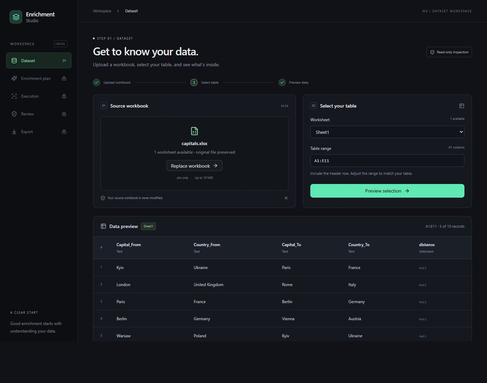
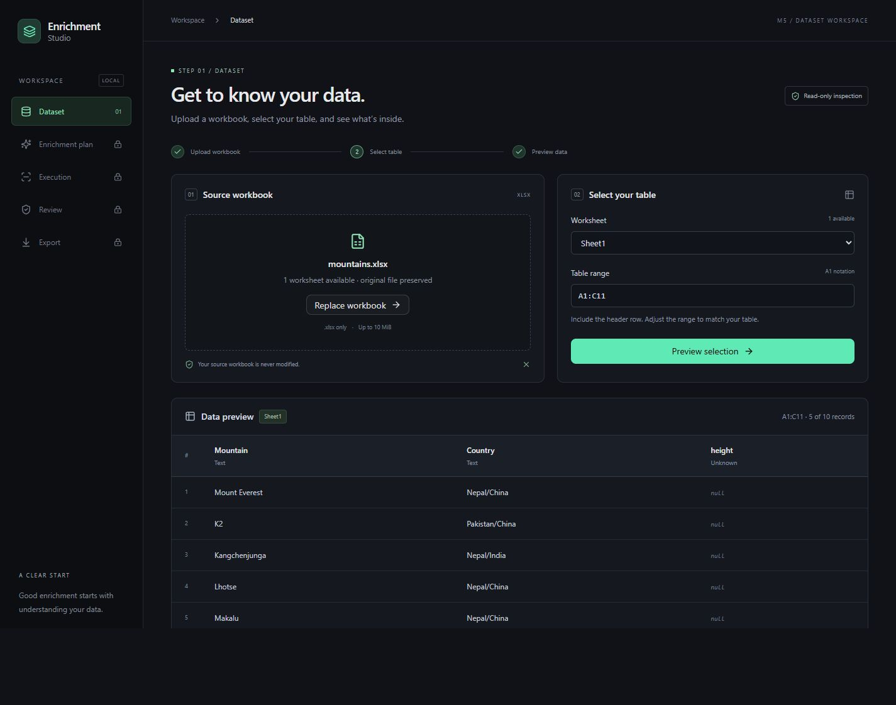

# M5-1 — Local Dataset Workspace

**Upload XLSX → inspect worksheets → select an explicit table range → preview
real data.** Built from `origin/main` at `cdc78f9`, including PRs #96 and #97.

The subsequent approved Data IDE integration, current interface screenshots,
localization and guided-range behavior are documented in
[M5-1 UI Foundation](21-m5-ui-foundation.md). This document retains the original
API/resource limits and first-slice acceptance evidence.

## Local startup

Requirements: Python 3.12+, uv, Node.js 24 and npm. From the repository root:

```powershell
# Terminal 1
uv sync --locked --group dev
uv run --locked uvicorn ai_data_enrichment.api:app --host 127.0.0.1 --port 8010

# Terminal 2
cd frontend
npm ci
npm run dev
```

Open [the workspace](http://127.0.0.1:5173). Vite proxies `/api` to port 8010;
no CORS configuration is required. Both servers bind to loopback. Stop them
with Ctrl+C. Port 8010 avoids an unrelated application already using 8000 during
acceptance. [API documentation](http://127.0.0.1:8010/docs) is also available.

## Architecture and changed files

- `src/ai_data_enrichment/api.py`: thin FastAPI adapter calling `inspect_workbook`,
  `TableSelection`, and `profile_worksheet`. It owns bounded streaming upload,
  ZIP/XML resource checks, temporary storage, and sanitized errors.
- `frontend/src/App.tsx`: React/TypeScript shell, file upload/drop target,
  worksheet/range form, and actual API-driven table. Sheet/range edits clear
  stale previews. Later workflow navigation is visibly disabled.
- `frontend/src/api.ts`: typed HTTP client with validation/network error states.
- `frontend/src/styles.css`, `components/ui/button.tsx`, `lib/utils.ts`:
  responsive dark workspace, Tailwind v4 and an adapted shadcn/ui button.
- `frontend/`: minimal Vite/TypeScript configuration, committed npm lockfile,
  React workflow tests, and HTTP-client tests.
- `tests/integration/test_workspace_api.py`: focused API, resource-limit,
  selection, cleanup, error-redaction, and source-preservation tests.
- `pyproject.toml`, `uv.lock`, `.gitignore`, `.github/workflows/ci.yml`, `README.md`:
  dependencies, generated-file exclusions, startup instructions, and CI checks.

The API stores uploads byte-for-byte under UUID filenames in a private
`TemporaryDirectory`. Client filenames are display metadata only. Opaque IDs
are looked up in memory, never interpreted as paths. Invalid uploads are removed
immediately; replacement/removal requests deletion, and normal API shutdown
removes all uploads. A lock serializes local mutations and preview reads;
ingestion runs in a thread pool. Existing resolution and Excel writer behavior
is unchanged. No Excel semantic parsing, planning, or execution is duplicated.

## HTTP contract

| Route | Request | Response |
| --- | --- | --- |
| `GET /api/health` | — | `{"status":"ok"}` |
| `POST /api/datasets?filename=capitals.xlsx` | Raw file bytes, `application/octet-stream` | 201: opaque ID, safe display filename, worksheet names/columns/non-empty row counts |
| `POST /api/datasets/{id}/preview` | `{"sheet_name":"Sheet1","range_ref":"A1:E11"}` | Selection, sample limit, existing `DatasetProfile` |
| `DELETE /api/datasets/{id}` | — | 204, idempotent removal |

Workspace errors use `{"error":{"code":"…","message":"…"}}`: invalid input
422, oversized upload 413, missing dataset 404, full workspace 409, unexpected
failure generic 500. Internal paths and cell contents are not echoed in errors;
exception details remain in server logs. Raw uploads stream to temporary files
and stop at 10 MiB, avoiding unbounded multipart buffering.

## Limits

- Local, single-user, one API process; no persistent sessions. Browser refresh
  resets the UI and backend restart invalidates IDs. Hard process termination
  may leave an OS temporary directory behind.
- Eight retained uploads maximum (80 MiB compressed total). UI replacement and
  removal release the current upload; refreshes may leave older uploads until
  shutdown. No dataset recovery/list UI is included.
- Unencrypted XLSX only. At most 16 sheet declarations, 2,048 ZIP entries, and
  32 MiB expanded archive size. Each worksheet must fit 5,001 rows, 100 columns,
  and a 100,000-cell rectangle; actual cell counts are also bounded. XML resource
  checks reject sparse enormous coordinates before ingestion, including data
  at unconventional archive paths.
- Combined worksheet header names must fit the shared 12 KB profile budget.
  Conservative workbook limits can reject large or heavily formatted inputs
  even when a smaller selection would fit.
- Shared `ProfilingLimits()` defaults: at most five aligned sample records,
  200 characters per value, 12 KB serialized profile. All selected non-empty
  records are scanned for types/counts. Byte limits may reduce samples further;
  warnings are displayed. The complete workbook remains preserved.
- A range includes unique, non-empty text headers in its first selected row.
  Initial range is a suggestion based on first-row columns and non-empty row
  count. Blank gaps and offset tables require editing the range.
- Inspection counts formulas as populated; preview uses cached formula results,
  following existing ingestion behavior. No formula calculation. Entirely
  empty rows are omitted; UI row numbers are sample ordinals.
- Wide tables scroll within their container; long values are visually truncated.
  This is a preview, not a spreadsheet editor or full worksheet viewer.
- No LLM planning, DAGs, provider execution, review/resume, accounts, background
  jobs or deployment. M5-2 must wait for review of this slice.

## Acceptance

On 2026-11-09, the actual Vite UI and FastAPI server were exercised through the
browser file chooser using the repository samples:

1. `samples/capitals.xlsx`, `Sheet1`, `A1:E11`: headers `Capital_From`,
   `Country_From`, `Capital_To`, `Country_To`, `distance`; ten records, five
   shown. First pair: Kyiv/Ukraine → Paris/France; distance stays null.
2. `samples/mountains.xlsx`, `Sheet1`, `A1:C11`: headers `Mountain`, `Country`,
   `height`; ten records, five shown, beginning Mount Everest, K2, Kangchenjunga,
   Lhotse and Makalu; heights stay null.
3. Desktop and narrow responsive layouts, range validation, correction/retry.

Actual running-interface screenshots:





[Narrow responsive preview](screenshots/m5-1/mountains-mobile.jpg).

Before/after source SHA-256 hashes match. API tests also compare temporary
uploaded bytes before and after profiling:

| Source | SHA-256 |
| --- | --- |
| Capitals | `9BEC067483D73D45302834307D2CBD090359C7C6A778CF2AC4CB9BD3D27298EC` |
| Mountains | `19E1DC3BE01DCC4F6446375B894D13BDEEA85E5BE2FD8639AE8616E6EB658450` |

## Verification commands

From the repository root:

```powershell
uv run --locked ruff check .
uv run --locked ruff format --check .
uv run --locked pyright
uv run --locked pytest -m "not live" --cov=ai_data_enrichment --cov-report=term-missing
uv run --locked python scripts/benchmark_m2.py --rows 1000
```

From `frontend/`:

```powershell
npm run format:check
npm test
npm run build
```

UI tests mock only the HTTP boundary for isolated state checks. The functioning
workflow and browser acceptance use the real API and source workbooks.

Local results: Ruff lint/format and Pyright pass; **1,226 Python tests passed,
2 explicit-opt-in live LLM tests skipped**, with 93% overall coverage and 98%
coverage of the API adapter. All **8 frontend tests** pass, TypeScript/production
build and formatting pass, and npm audit reports zero vulnerabilities. The
existing M2 benchmark passes both 1,000-row workloads and adversarial cases.
