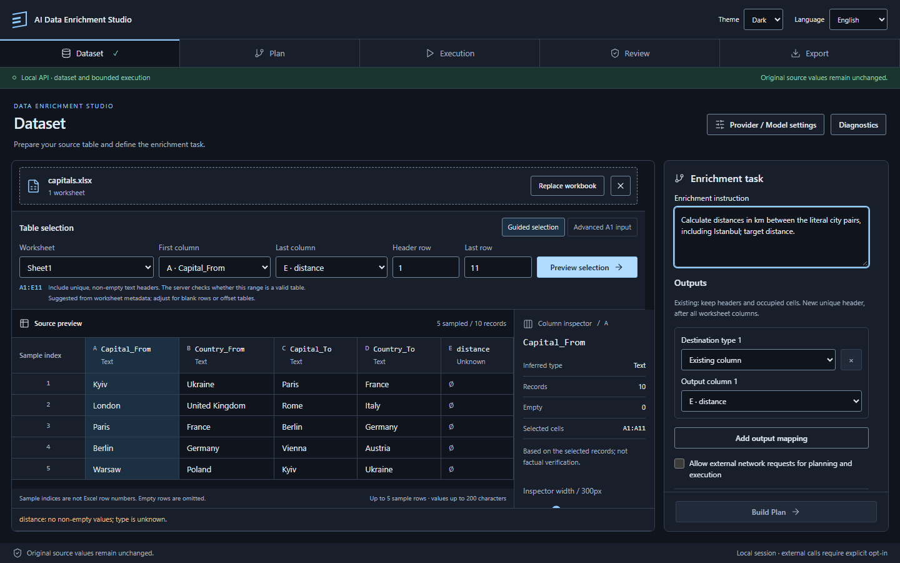
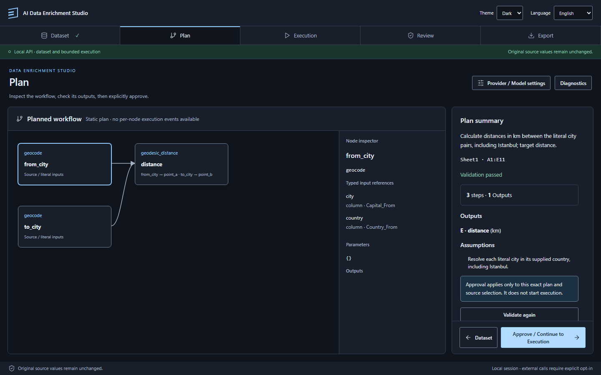
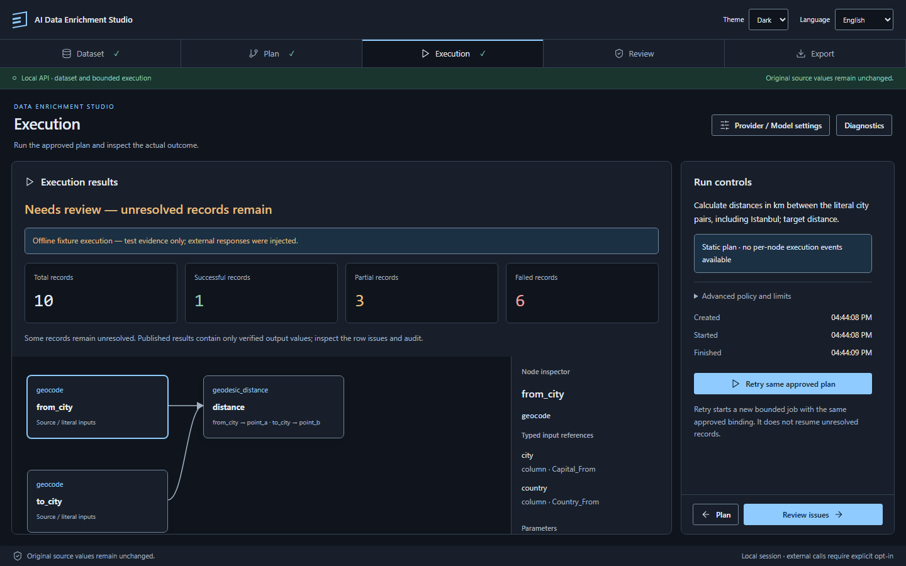
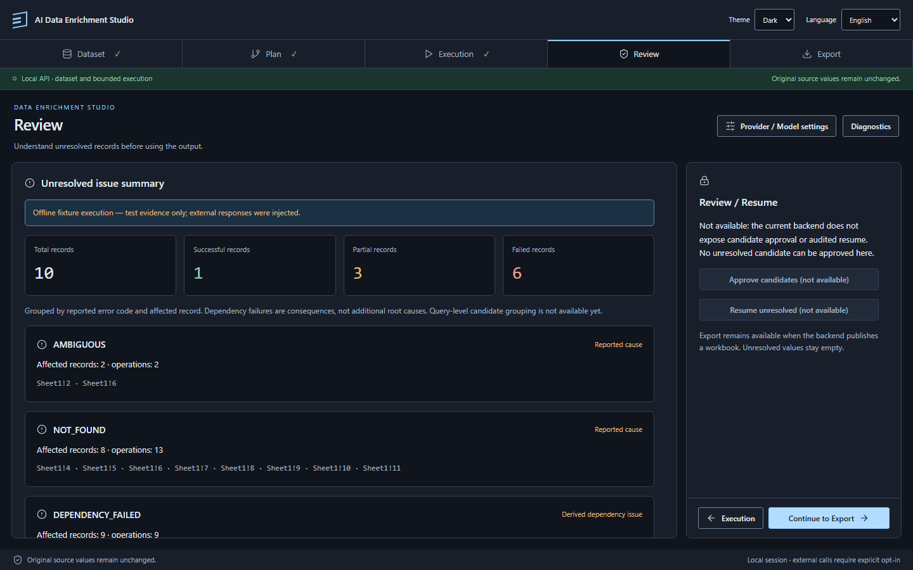
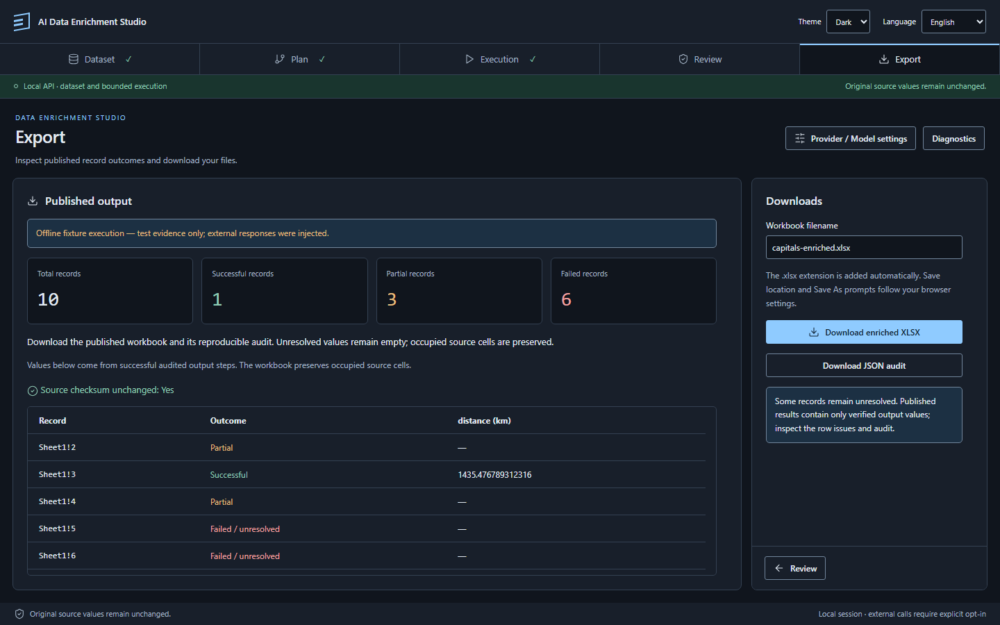

# Five-workspace Data Enrichment Studio

Implements the immediate UI foundation in [#112](https://github.com/ayri77/ai-data-enrichment-studio/issues/112). The application now has five real, freely navigable workspaces. It uses the existing FastAPI Plan/Run routes and Python execution pipeline without backend changes.

## Run and demonstrate

Use the backend environment and frontend startup commands in [the E2E-0 setup](23-e2e0-browser.md#start-the-real-application). The regular application has no fixture selector or simulated execution fallback.

1. **Dataset:** upload an original sample, select its worksheet/range, and preview. The range offered first is the table the server found on the sheet (`ingestion/table_detection.py`): a header row of at least two adjacent text cells with unique names and the rows under it down to the first empty row, wherever on the sheet it is, so a title above the table or empty columns beside it do not have to be worked around by hand. It is a guess for the default selection only; the selected range is validated as before and can be changed. A sheet with nothing that looks like a table is offered from A1 as before. Enter the enrichment instruction. Choose an existing output by letter/header (`E · distance` for Capitals, `C · height` for Mountains). Alternatively choose **New column**, supply its physical letter or one-based index and a unique header. New destinations must follow all known worksheet columns, even when some lie outside the selected range. The backend still validates bindings and preserves occupied cells. While no workbook is loaded, bundled examples can be started with one click: the example goes through the ordinary upload and preview and arrives with its instruction and output column; its prepared plan can replace the AI request ([hosted demo](27-hosted-demo.md), "Examples"). The task panel also asks what to do **if the source confirms exactly one match** while other matches with the same name could not be confirmed: *fill it in automatically* (the UI default; this is the existing `verified_only` policy) or *ask me to confirm* (`strict`). The API and CLI default stays `strict`; the UI always sends its choice explicitly. Next to **Build Plan** the screen lists what is still missing (preview, selection limit, instruction, output column, external-request consent, provider readiness). The same list enables the button, so the two cannot disagree; a missing model or key links straight to Provider / Model settings.
2. Opt in to external requests for AI planning/execution. **Build Plan** requests generation and validation, then opens Plan. Alternatively expand **Use an existing plan**, paste a supplied plan, and choose **Submit and validate plan**; this validation works offline. Named plan outputs must match the selected headers. Existing demo plans are in `demo/`.
3. **Plan:** inspect the actual typed DAG, select a node to see its bindings, capability, parameters and outputs/units, and check validation and assumptions. **Approve / Continue to Execution** approves the exact server fingerprint and opens Execution. It does not start a job. Diagnostics exposes the fingerprint and full source binding.
4. **Execution:** choose **Start bounded run**. Status comes from real polling; the static DAG does not claim node execution progress. Counts appear only when the backend reports them. Cancellation remains a request until the server confirms a terminal status. Navigate to any workspace while the job runs; input mutations stay locked and polling continues. Completion stays on Execution with **Review issues** or **View output**.
5. **Review:** settle ambiguous names and fill the remaining rows. The screen is built on the two review routes ([plan/run API](22-m5-plan-run-api.md), "Review and resume") and has two layers. *First layer:* one card per ambiguous source query (not per row) with the affected rows, the candidates as a single choice, plain distinguishing facts (region, country, role, population, coordinates; for a mountain the source's own description, its recorded elevation and coordinates), a link to an independent page (map or Wikidata), a **Recommended** badge with its reason when the backend suggests one, and an explicit **Leave empty**. An option with coordinates has **Map**: a window over the page with OpenStreetMap's embeddable map and a marker on the place, the option's facts, steps to the neighbouring options of the same name ("Option 2 of 5"), three zoom levels and **Choose this one**, so options are compared and chosen in one place instead of in browser tabs. The map is requested from openstreetmap.org only when the window is opened; its address carries the coordinates and nothing else. Mountains have it too, beside the link to their Wikidata entry. Names without any match are listed separately with nothing to choose. Every name the source might know under another spelling, with or without candidates, has **Search under another name** (a closed `details` with one text field and **Search**). The source is asked at once; the waiting bar names the search and counts the time. What the source confirmed under that name is listed below the field as further options of the same choice ("Found under …"); nothing is written until one is chosen and the remaining rows are filled. A chosen match folds to the usual chosen block with "found under …"; a new search for the same name drops a choice made from the earlier one. No confirmed match and a source that did not answer are said in different words. A name the earlier run already searched is shown as "Searched as …". Under the field, **Ask the AI for other names** sends the name, its kind and its country to the model (the text beside the button says so before anything is sent) and lists the proposed names as buttons; choosing one fills the field and runs the same search. A proposal is never a result. The button needs what planning needs and is disabled with an explanation otherwise. *Second layer* (closed `details`, marked `data-advanced`): operation ID, provider, decision and reason codes, record → step links, per-candidate verification and evidence, the matches that cannot be chosen (collapsed, with the reason for each), and the earlier per-error-code summary, where `DEPENDENCY_FAILED` remains a derived issue. A card that has a choice folds to that choice with a **Change** link, so a long list of look-alike places is on screen only while choosing: a choice made with the pointer folds the card at once, **Accept recommendations** folds the cards it filled, an open decided card has **Hide the options**, and decided cards come back folded after navigation. A choice made from the keyboard does not fold the card, because arrow keys select while moving through the options; when a card folds, focus moves to **Change**. **Accept recommendations** fills only undecided cards and never overwrites a choice. **Fill in remaining rows** sits in the footer of the side panel, with the navigation buttons: while a choice is made and not applied it is the main action there, a note says that the choices are not in the results yet, and the way on is labelled "Results without filling". It needs at least one chosen candidate, listed or found by a search, and the network opt-in; it starts a new job on the same approved plan, moves the earlier job to Diagnostics history and returns to Execution. Choices live above the workspace bodies, so navigation and language changes keep them; a new run, a resume or any binding edit clears them. Unknown codes are shown verbatim rather than hidden.
6. **Results:** check the results row by row, then download the actual XLSX and JSON audit separately. *First layer:* each row shows its Excel row number, the source values the plan used, the output value rounded for reading with its unit (the exact value is the cell tooltip; workbook and audit keep full precision), and a result note. An empty cell says why in plain words (the first real failure in the row, not its `DEPENDENCY_FAILED` consequences) and links to Review when a choice can still be made there. Values that exist only because of a user choice are highlighted and labelled with the chosen name. Values accepted automatically while other matches stayed unconfirmed say so and have their own filter. A filter (all / filled / empty / after your choice), sorting by any column (empty values stay last) and a short summary per output column (filled count; min, max and average for numeric columns) change only what is shown. *Second layer* (row toggle, `data-advanced`): every step of the row with its returned value and source record, plus the record ID and the `success | partial | failure` classification. The table is built from the audit, not from a re-read of the result workbook.

Timeout lives in the **Advanced policy and limits** disclosure on Dataset; changing it does not invalidate the plan. A policy change invalidates approval and requires a newly validated/approved plan. **Retry same approved plan** starts a distinct job with the unchanged approved binding; it never implies reviewed resume. Status/report retry only recovers polling. Editing source selection, instruction, mapping, supplied plan, consent or policy clears the current downstream binding/results. The last eight job/report/plan snapshots remain in session-only Diagnostics history and cannot silently become the current result.

The shared controller stays mounted above workspace bodies. This persistence covers navigation, language and theme changes within the current browser session. Browser reload still loses the UI session and does not cancel a backend job. There is no new durable storage or job recovery API.

## Layout and accessibility

The shell, navigation and workspace actions stay inside the desktop viewport. Source configuration, table, column inspector, graph, node inspector, summaries and Diagnostics scroll within bounded panels. At narrow widths or short heights, the page can scroll so controls remain reachable. Navigation uses ordinary keyboard-accessible buttons with current/completed semantics and focuses the workspace heading after a change. The native Diagnostics dialog traps focus, closes with Escape and restores focus to its trigger. Status labels accompany semantic colors. EN/UK/DE and both existing themes share the same workflow state.

## Waiting

Whenever the studio waits, one line under the heading of every step says what for, in plain words: reading the workbook or the selection, building or checking a plan, approving, starting a run, the run itself, preparing a download. Beside it runs the time elapsed since the wait began (browser clock). For a short request a moving stripe signals activity only, and nothing claims a percentage. A run reports its rows: the worker counts finished rows and the job status carries `progress` (`rows_done`, `rows_total`), so the line says "Rows processed: 4 of 10", the stripe is as long as that share, and from the second finished row an estimate of the time left is added ("about 0:20 left"). The estimate is the pace so far applied to the remaining rows, rounded up to five seconds; rows differ, so it is a guess and is worded as one. The line also gives the time limit after which the server stops the run.

- A **short request** (everything except the run itself) keeps the user on its step: the other steps are disabled with the tooltip "Wait for the current operation to finish", because the request ends by opening its own step anyway. The pressed button shows a spinner.
- A **running job** does not hold the user in place. On any other step the line adds that the data and the task cannot be changed until the run finishes, and links back to the run. Input locking itself is unchanged.

`ActivityBar` (`frontend/src/components/ActivityBar.tsx`) reads the operation from the workflow controller (`operation`, `jobSince`) and the dataset hook (`busy`, `busySince`). The status text is a live region; the clock is a `timer`, which screen readers do not announce on every tick, and the row count stands outside the live region for the same reason. With reduced motion the stripe and spinner stand still.

## Basic and Advanced modes

The header has a **Mode** switch next to theme and language. The choice is kept in the browser (`enrichment.mode`); a first visit starts in **Basic**. Both modes use the same controller, routes and validation: the mode changes what is shown, never what the server accepts.

**Basic** keeps what a person filling a table needs: workbook and examples, instruction, the column to fill, plan summary with outputs and assumptions, run status and counts, the choices on Review, and the result table with its filter, sort, statistics and the XLSX download. On Dataset it asks for three things only — a file, an instruction, a column:

- **Existing values in the chosen output column are announced before the run.** As soon as an existing column is chosen for an output, the task panel counts the rows of the selection in which that column already holds a value and names them ("2 of 10 rows already have a value (rows 7, 9)"), from the rows of the preview. The person chooses what happens to them: **keep** (the default; only empty cells are filled) or **replace where a new value is found**. The choice is part of the plan request (`existing_outputs`), so it is covered by the plan's fingerprint and carried into a resume; a new workbook starts from "keep" again. With "replace" a new value is written over the earlier one only where one was produced: a row whose lookup failed keeps what it had, a formula included. The source file is never changed. The audit lists `preserved_cells` and `replaced_cells` (cell and earlier value), and each result row has `kept_outputs` and `replaced_outputs`. On Results a kept cell reads "kept" with "Kept the value it already had" (the value that was found is in the cell's tooltip and is not in the file), and a replaced one shows the new value with "Replaced the earlier value: …". A kept row does not count as filled by the run.
- **Looking at a table and filling it are two things.** The preview always takes the whole table found on the sheet, up to what the server reads (`GET /api/limits`: `max_table_rows`, `max_table_cells`; a longer table says how much of it was loaded). How many of its rows one run fills is a separate field in the task panel, **Rows to fill, from the top of the table**: by default as many as a run accepts (`max_run_rows`), fewer on request, with the worksheet rows it means ("The first 20 of 999 rows will be filled (worksheet rows 2–21)"). The plan request carries the range of those rows only (`tableModel.ts`, `runRows`), so a table longer than a run accepts no longer prevents a plan. Rows outside the run are shown dimmed. Only the first rows can be taken: a run of rows from the middle, or of the rows a filter matches, needs the server to accept a header that is not directly above the data, and is not offered.
- **The whole selected table can be looked through.** The preview response carries every non-empty data row of the selection in `rows` (`ingestion/table_rows.py`): worksheet row numbers and cell values as shown, text cut to 200 characters. The source table shows 20, 50 or 100 of them, or all ("Show"), with the worksheet row number in the first column, a text filter over all cells and one sortable column; the filter, the row count and "Show" sit in the table's heading line (ascending, descending, worksheet order). Numbers sort as numbers and before text, text sorts as read ("row 2" before "row 10"), empty cells stay last. Filtering and sorting change only the view: the selection, the plan and the run are untouched. The profile, with its five sample rows, is unchanged and remains the only table content a planning request may carry; `rows` never leave the workspace.
- **The task belongs to the table, not to its boundaries.** Adjusting the selected range and previewing again keeps the instruction, the output column and a pasted plan; only the plan draft and the run made for the old selection are dropped. Another workbook or another sheet is another table and starts empty.
- **The table is read on upload.** The first sheet is previewed from `A1` without a button, taking no more data rows than one run accepts (`GET /api/limits`); a longer table gets a note with the numbers. The boundaries appear when the table could not be read, when the workbook has several sheets, or behind the link "Change its boundaries".
- **One question, "Which column to fill?"**, with the table's columns and "A new column…", which is placed right after everything the sheet holds. If exactly one column of the table is empty, it is proposed (in both modes) as long as nothing was chosen yet. Several outputs and a new column at a chosen address are Advanced.
- **No consent checkbox.** Pressing "Build Plan" is the consent, and the line above the button says what leaves the browser: the instruction and a sample of the table go to OpenAI when the AI plans, and the run looks the names up in the open sources. Nothing is said when the server works on fixture answers. Advanced keeps the checkbox.
- **Before a workbook is chosen**, the empty table area states what can be asked for (city coordinates, distance between two cities, a mountain and its elevation), that countries must be written in English or as a two-letter code, and the row limit. The instruction field shows an English example, and says that only English instructions have been checked.

On Plan, Basic puts the plan into words instead of drawing it:

- **"What will be done"** lists, for each row, the steps in the order they depend on each other, with the columns they read and the column the result is written to ("Find the mountain — Name: column “Mountain” · Country: column “Country”", "Look up the elevation — Written to column “height” (C), m"). The sentences come from `frontend/src/planModel.ts`, which only reads the plan the server validated. A capability the interface has no words for is listed under its own name, so the description never hides a step; a value written into the plan is shown as "the same for every row".
- **One button, "Approve and run".** It sends the approval of the displayed fingerprint and then the start, one request after the other; the server still refuses a start without approval. If the start is refused, the plan stays approved and Execution offers the start again. Once the plan has a run, the button leads to it instead of starting another. Advanced keeps approval and start as two actions.
- **When there is no plan to run**, the screen says why in a sentence. A refusal by the planner (`unsupported`, `ambiguous`) shows the model's own explanation, marked as such, the list of what the system can do, and the advice to rephrase; this block is the same in both modes. A plan that failed validation shows "This plan cannot be run", the validator's messages behind "What the check reported", and the steps as the planner understood them. Error codes and step ids stay in Advanced. Validation itself is unchanged.
- A long instruction is folded in the summary.

On Execution, Basic says what happened instead of listing counters:

- **While the run goes on**: a progress bar with the rows processed and the estimate of the time left, and the cancel button.
- **When it ends**: one sentence — "All rows are filled: 10 of 10", "Rows filled: 7 of 10", or "None of the 10 rows could be filled" — followed, when rows are left, by "Names waiting for your choice: 2" or "The rest could not be confirmed and were left empty". The filled count is taken from the same rows the Results step lists (`frontend/src/runModel.ts`), so the two screens cannot disagree; the job's own counters are used only until the report has arrived.
- **When it ends without a table** (failed, cancelled, timed out): what happened, how many rows were processed before the stop, for a timeout the advice to select fewer rows, and the button **Run again**, which starts the same approved plan. "View output" is disabled, because there is nothing to view.
- **Start over with another table**, on Execution and on Results in both modes, removes the workbook and returns to Dataset with the examples. The server forgets a removed workbook together with its results, so when a filled table exists the button first says so on the page and asks to confirm.

**Advanced** adds the second layer:

- the connection band, **Provider / Model settings** and **Diagnostics**;
- on Dataset: table boundaries always in view with the **Preview selection** button, A1 range input and its guidance, column types and the column inspector, the output mapping with several targets, the consent checkbox, the single-match policy, **Use an existing plan** (plan JSON), **Advanced policy and limits** (timeout), provider readiness lines;
- on Plan: the graph with its node inspector instead of the description in words, sheet and range, step/output counts, validation codes, **Validate again**, and approval as a separate action from the start;
- on Execution: the status with its four counters and the error code, the plan graph, run timestamps, **Retry same approved plan** after any run;
- on Review: matches that cannot be chosen, technical details, error codes;
- on Results: per-row step detail, workbook filename, JSON audit download, the source checksum confirmation (a *changed* source is reported in both modes).

In Basic the **Review** step is available only when a run needs a choice; a finished run without one leads straight to Results. When the example's prepared plan is in use, Basic says so and offers to drop it, because the plan JSON field is an Advanced tool. On a hosted demo (the server asks for an access code) the texts name the demo instead of a local session, and the provider hints do not suggest a local start.

`Advanced` from `frontend/src/mode.tsx` renders its children in Advanced only; `useAdvanced()` serves the few places that need a different layout. The existing unit and browser suites run in Advanced; Basic has its own tests and the one-click example scenario runs in it.

## Provider setup and deferred work

**Provider / Model settings** now exposes non-secret readiness, a supported OpenAI model picker, and masked key apply/replace/remove actions. Keys stay in backend process memory. See [the trusted local launcher, access boundary, and acceptance steps](25-provider-settings.md). The separate network-consent state and server gate remain authoritative.

Advanced DAG editing/strategy tooling remains in #101; actual node events and playback in #102; candidate Review/Resume in #103/#68. Autonomous agent visualization, advanced analytics and a complete Simple/Advanced product mode are outside this slice. Live Mountains acceptance remains deferred as agreed; these tests do not assert independent live academic accuracy.

## Verification and evidence

```powershell
# Repository root
uv run --locked ruff check .
uv run --locked ruff format --check .
uv run --locked pyright
uv run --locked pytest -m "not live" --cov=ai_data_enrichment --cov-report=term-missing
uv run --locked python scripts/benchmark_m2.py --rows 1000

cd frontend
npm run format:check
npm test
npm run build
npm run test:e2e
```

Browser tests start an isolated real API on 8011 and Vite on 5174. Only model/provider responses are injected offline. Both original workbooks still traverse upload, selection, real planning/validation, exact approval, spawned Python execution and actual downloads. Downloaded workbooks are independently inspected with openpyxl for values, original cell/style preservation and unresolved empty cells. Offline fixtures intentionally yield **1 successful / 3 partial / 6 failed** Capitals records and **1 successful / 9 failed** Mountains records, not the previously observed live baselines. All result screens explicitly identify offline fixture execution.

Additional acceptance covers navigation while a real job's status response is delayed (the response remains unmodified), no cancellation on navigation, localization/theme preservation, stale-state invalidation, offline supplied-plan validation, invalid plans, new-column coordinates outside the selected range, header/coordinate collisions, real output at `F` without shifting existing `E`, keyboard modal access and a 390px mobile flow.

For each of the five workspaces and both files, the browser suite checks document width/height and action visibility at **1366×768, 1440×900 and 3440×1440** and captures screenshots. Other tests cover terminal errors, cancellation, status retry, same-plan retry, late responses and source-bound approval. These are integration and UI acceptance evidence, not a substitute for independent numeric/source evaluation or a recorded live submission demo.

Local verification on this branch: **1,262 Python tests passed, 2 live tests skipped; 101 frontend tests passed; all 5 browser acceptance cases passed.** Ruff lint/format, Pyright, the 1,000-row controlled benchmark, frontend formatting and the production build also passed.

## Desktop screenshots (offline integration evidence)

| Workspace | 1366×768 | 1440×900 | 3440×1440 |
| --- | --- | --- | --- |
| Dataset | [Open](screenshots/issue-112/capitals-dataset-1366x768.png) | [Open](screenshots/issue-112/capitals-dataset-1440x900.png) | [Open](screenshots/issue-112/capitals-dataset-3440x1440.png) |
| Plan | [Open](screenshots/issue-112/capitals-plan-1366x768.png) | [Open](screenshots/issue-112/capitals-plan-1440x900.png) | [Open](screenshots/issue-112/capitals-plan-3440x1440.png) |
| Execution | [Open](screenshots/issue-112/capitals-execution-1366x768.png) | [Open](screenshots/issue-112/capitals-execution-1440x900.png) | [Open](screenshots/issue-112/capitals-execution-3440x1440.png) |
| Review | [Open](screenshots/issue-112/capitals-review-1366x768.png) | [Open](screenshots/issue-112/capitals-review-1440x900.png) | [Open](screenshots/issue-112/capitals-review-3440x1440.png) |
| Export | [Open](screenshots/issue-112/capitals-export-1366x768.png) | [Open](screenshots/issue-112/capitals-export-1440x900.png) | [Open](screenshots/issue-112/capitals-export-3440x1440.png) |

Mountains at 1440×900: [Dataset](screenshots/issue-112/mountains-dataset-1440x900.png), [Plan](screenshots/issue-112/mountains-plan-1440x900.png), [Execution](screenshots/issue-112/mountains-execution-1440x900.png), [Review](screenshots/issue-112/mountains-review-1440x900.png), [Export](screenshots/issue-112/mountains-export-1440x900.png).







Provider / Model settings now support [backend-owned ephemeral local setup](25-provider-settings.md) (#113), replacing the original not-reported placeholder.
