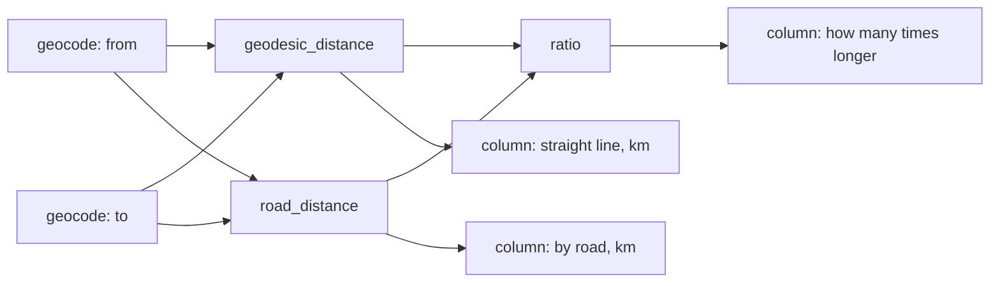

# Road distance and ratio: two capabilities added after 0.1.0

**Status:** implemented and covered by offline tests. **Not verified against the
live routing service** — the session that wrote it had no key and no network
access to it. The live check at the end of this note is the owner's step, and
the planning measurement has to be repeated because the capability set changed.

The note separates what the sources and the code show (evidence), what follows
from it (inference) and what is proposed (recommendation).

## What was added

| Capability | Kind | Source | Offered |
| --- | --- | --- | --- |
| `road_distance` | asked from a service for two coordinates | openrouteservice (HeiGIT), profile `driving-car`, on OpenStreetMap data | only when `OPENROUTESERVICE_API_KEY` is set |
| `ratio` | computed | none | always |

Together with the existing lookups they allow a plan that is not a straight
line of steps and fills more than one column:



Five steps, three output columns. A row whose cities have no road between them
keeps its straight-line distance and leaves the other two cells empty.

## Evidence: the routing source

Read on 2026-11-13; the limits belong to the service and can change.

- **Host.** `api.openrouteservice.org` was deprecated on 2026-04-28, cut to 10 %
  of the quota on 2026-08-27 and scheduled for shutdown on 2026-11-02 to 06
  ([announcement](https://ask.openrouteservice.org/t/deprecating-api-openrouteservice-org-in-favour-of-api-heigit-org/7912),
  [quota notice](https://ask.openrouteservice.org/t/reducing-the-quota-of-deprecated-api-api-openrouteservice-org/8013)).
  The adapter uses `https://api.heigit.org/openrouteservice/v2/directions/driving-car`.
  Existing keys work on the new host.
- **Key.** A free account at `account.heigit.org`; the key is sent in the
  `Authorization` header, without `Bearer`.
- **Free plan.** Directions: 2,000 requests a day and 40 a minute. Over the
  minute limit the service answers 429, over the daily limit 403.
- **Restrictions** ([list](https://openrouteservice.org/restrictions/)): a
  driving route may be at most 6,000 km long.
- **Alternative considered.** The public OSRM demo server needs no key, but it
  is a demonstration service without guarantees whose usage policy rules out
  heavy or production use. Not used.

## What the code does

- `providers/openrouteservice.py` — `OpenRouteServiceDistanceHandler` sends one
  `POST` per pair of points with `geometry` and `instructions` switched off, so
  the answer holds the length and not the path. Longitude comes first in the
  request. The same point twice is answered with 0 km without a request.
- `providers/http_transport.py` — `post_json`, and the JSON body of an error
  answer is kept on `JsonTransportError.payload` (bounded to 4 KiB, never part
  of the message). `providers/retry_transport.py` retries a `POST` under the
  same policy as a `GET`; a route request changes nothing at the source, so
  repeating it is safe.
- `providers/ratio.py` — `RatioHandler` divides two quantities of the same
  unit. Different units and a zero divisor are failures; nothing is converted.
- `capabilities/definitions.py` — `get_road_distance_spec`, `get_ratio_spec`
  and `offered_capabilities(road_distance=...)`. `get_builtin_capabilities`
  still returns the four of release 0.1.0; the command line and the benchmarks
  use that set and are unchanged.
- `plan_run_worker.py` — `builtin_registry()` registers `road_distance` only
  when `routing_key()` finds a key. Without one the planner is not told about
  it and a plan that asks for it fails validation with `UNSUPPORTED_CAPABILITY`.
- `orchestration/live_executor.py` — binds both capabilities when the registry
  holds them; the key travels in a header of the routing transport only. Routes
  are kept for later runs of the same plan like other lookups
  (`RESULT_REUSE_SECONDS`).
- `GET /api/limits` lists the ids of the offered capabilities; the interface
  names a road distance among what it can do only when it is listed.

### Failures a row can end with

| Code | When | In Results |
| --- | --- | --- |
| `NO_ROUTE` | the service's code 2009 | no road route between the places |
| `POINT_NOT_ON_ROAD` | code 2010: no road within the service's search radius of a point | no road near one of the places |
| `ROUTE_TOO_LONG` | code 2004 | too far apart for the service |
| `SOURCE_ACCESS_DENIED` | HTTP 401 or 403 | key not valid or daily quota used up |
| `RETRY_EXHAUSTED`, `PROVIDER_ERROR`, `INVALID_RESPONSE` | as for the other sources | the source did not answer |
| `UNIT_MISMATCH`, `DIVISION_BY_ZERO` | `ratio` | generic wording with the code |

A 404 or 400 without one of the three known codes is reported as a failed
request, never as "no route": a wrong address must not look like an answer.

### What the value is, and what the audit says

A road distance is not read from a record that could be opened and compared. Its
evidence is `openrouteservice` with the reference `driving-car:osm-<date>`,
where the date is the `graph_date` the answer states for its road data. The plan
description adds a note to the step that the value is computed by a routing
service and that there is no source record to check it against. The same value
can differ after the service updates its data; the audit records which data it
came from.

What leaves the workspace for this source: two pairs of coordinates per row.
No names and no other cell values.

## Inference

- **A fifth and sixth capability change what the planner is shown.** Planning
  was measured with four capabilities (10 of 10 on each sample task,
  [live planning reliability](26-live-planning-reliability.md)). Two sets exist
  now: five without a routing key (`ratio` added), six with one. Neither has
  been measured.
- **An instruction that asks for a driving distance used to be refused.** With a
  key it can now be planned; without one it still has to be refused. Both
  behaviours are unmeasured.
- **One run of 20 rows stays inside the minute limit** (at most 20 requests,
  fewer when pairs repeat). Several runs within a minute, or a locally raised
  `ENRICHMENT_MAX_RUN_ROWS`, can exceed 40 a minute: the run retries twice with
  a short pause and then leaves the row empty with `RETRY_EXHAUSTED`. Requests
  are not paced to the limit.
- **City coordinates are centre points.** Whether the service always finds a
  road within its default search radius of them is not known; that is what
  `POINT_NOT_ON_ROAD` would show in a live run. The radius was left at the
  service's default on purpose: widening it changes which road a place is
  attached to and should follow evidence, not precede it.

## Not covered

- No live request was made. The request shape and the error codes follow the
  service's documentation and public reports of its answers; the fixture
  (`evaluation/plan_run_fixtures.py`) answers in that shape with round figures
  for four cities and is not evidence about the service.
- The key is read from the environment only. It cannot be entered in the
  browser's provider settings.
- Only `driving-car` and kilometres. Other profiles and travel time are
  contract changes.
- `ratio` divides quantities only; it does not take plain numbers from columns.
- The hosted demo is unchanged until the key is set there. A shared instance
  spends one account's daily quota for all visitors.

## Checks for the owner

1. **Key.** Put `OPENROUTESERVICE_API_KEY=<key>` into the local `.env` and start
   the server with `--env-file .env`. `GET /api/limits` then lists
   `road_distance`, and the start screen names the road distance.
2. **One live run.** In Advanced mode add three output columns to the Capitals
   example and ask for the straight-line distance, the driving distance by road
   and how many times longer the road is. Look in Results at the source record
   of the road step and at any row left empty, and note its code.
3. **Planning measurement,** with the key set and again without it:

   ```bash
   uv run --env-file .env python -m scripts.experiment_planner --case capitals \
     --model gpt-6-luna --reasoning-effort low --repeat 10
   uv run --env-file .env python -m scripts.experiment_planner --case mountains \
     --model gpt-6-luna --reasoning-effort low --repeat 10
   ```

   The script prints the capability set it measured and stores it in
   `summary.json`. Deploy only after both tasks are still 10 of 10.

## Recommendation

- Keep `road_distance` behind its key until the live run and the measurement
  are recorded here.
- Decide after the live run, with its codes in hand, whether the search radius
  around a point needs a stated value.
- Express both capabilities through the binding of
  [the design note](29-capability-extension-design.md) when its step 1 is
  done; they were written against today's structure and touch the places that
  note lists (contract, executor assembly, interface wording).
